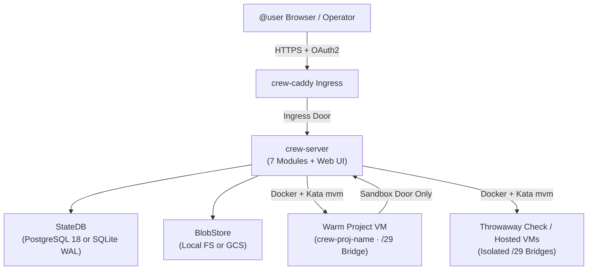
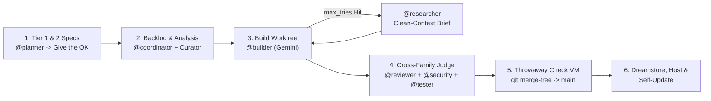
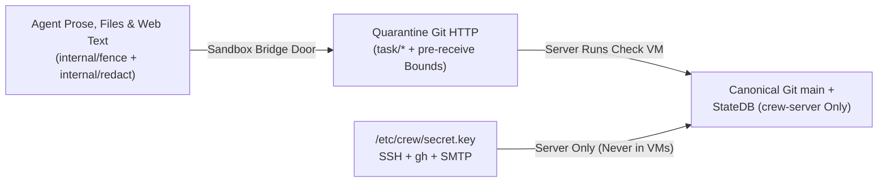

# Crew

Crew `2.0` is a self-hosted **Software Factory per project** worked by AI peer agents instead of people. Each project factory runs inside its own warm Kata Containers microVM (`crew-proj-<project>`) with isolated per-run git worktrees (`agy acp --stdio --process-per-session` over Crew's **Agent API**), while throwaway microVMs execute checks, setups, and hosted project apps. You approve Tier 1 foundation planning (`.crew/specs/000-foundation.md`) once with **Give the OK**; after that, peer agents carry features and tickets autonomously from `Backlog` to `Done`, notifying you in **Inbox** (and optional email) only when a human decision is required.

## How Crew Works

Crew coordinates planning, execution, isolated testing, and memory evolution through seven explicit backend modules paired with hardware-virtualized microVMs. Zero agent compute runs without a tracked **Tasks API** work unit, and only `crew-server` writes to `StateDB` or canonical `main`.



### Seven-Module Control Plane

Every responsibility inside `crew-server` maps to one of four domain APIs or three runtime and storage layers (`Design 5.1`, `M21`–`M26`).

| Layer | Module | Contract (`Design 2.0`) | Deep-Dive Guide |
| :--- | :--- | :--- | :--- |
| Domain API | **Tasks API** | Mandatory pre-compute work boundary (`FactoryTask`), `.crew/tickets/<KEY>.md` YAML mirror, token ledger, and Kanban `Backlog` -> `Done` flow (`R217`). | [02. Tasks API & Pipeline](docs/features/02-tasks-api-and-stage-pipeline.md) |
| Domain API | **Knowledge API** | Installation-wide secret-scrubbed (`internal/redact`) and provenance-fenced (`<crew_data_fence>`) shared skills, bug advisories, and spec patterns (`R218`). | [06. Memory & Knowledge](docs/features/06-memory-dreamstore-and-knowledge.md) |
| Domain API | **Skills Registry** | Four-tier catalog (`Base`, `Cross-Factory Shared`, `Project & Dream`, `Vendored` SHA-pinned) with static AST vetting and live warm-VM sync (`R221`). | [07. Skills Registry](docs/features/07-skills-registry-and-harness.md) |
| Domain API | **Memory API** | Project-scoped **Dreamstore** (`episodic`, `semantic`, `procedural`, `0.00`–`1.00` validity with drift decay and `< 0.40` quarantine) and `@dreamer` (`R215`–`R216`). | [06. Memory & Knowledge](docs/features/06-memory-dreamstore-and-knowledge.md) |
| Domain API | **Agent API** | Multi-session ACP peer control plane (`1 session = 1 peer agent` on `agy acp`), `@coordinator` dispatch, `max_tries` -> `@researcher`, and `#<project>` routing (`R212`, `R214`). | [03. Agent API & Peers](docs/features/03-agent-api-and-peer-specialists.md) |
| Runtime | **Harness Runtime** | `internal/cli/` adapter (`agy` active; `pi`/`claude` seam), `WORKFLOW.md` read from canonical `main` (`13.8`), live skill overlay, and per-session MCP tokens. | [03. Agent API & Peers](docs/features/03-agent-api-and-peer-specialists.md) |
| Runtime | **ComputeRuntime** | Formal lifecycle interface (`Start`, `Exec`, `Suspend`, `Resume`, `Snapshot`, `Restore`, `Stats`, `Destroy`) over Docker+Kata (`K8s` seam open, `R219`). | [05. Sandboxes & Runtime](docs/features/05-sandboxes-and-compute-runtime.md) |
| Storage | **StateDB + BlobStore** | Split storage: `PostgreSQL` (`crew-db`) or embedded `SQLite` WAL paired with immutable `Local FS` or `GCS` blobs (`.jsonl.zst` trajectories, `512 MB` snapshots, `R220`). | [09. Split Storage & Git](docs/features/09-split-storage-and-git-store.md) |

### End-to-End Factory Pipeline

From initial prompt to hosted deployment, tickets advance strictly left-to-right across verifiable gates.



1. **Plan foundation and features:** Draft `.crew/specs/000-foundation.md` and `WORKFLOW.md` with `@planner`, review the initial breakdown, and click **Give the OK** once. Subsequent feature specs (`.crew/specs/NNN-<slug>.md`) converge either with you or autonomously between peers and `@planner` inside `feat/<NNN>-<slug>` threads.
2. **Schedule and build in isolated worktrees:** `curator` and `@coordinator` populate ticket contracts, then dispatch `@builder` into isolated `task/<KEY>-<slug>` worktrees inside the project's warm microVM. Repeated failures past `max_tries` (default `3`) trigger a clean-context `@researcher` brief (`<KEY>-research.md`).
3. **Verify across model families and check sandboxes:** `@reviewer`, `@security`, and `@tester` inspect the branch using Anthropic (`claude`) models for code and verification judging when `3p` quota permits (`Rule 15`), while all construction, planning, coordinating, researching, testing, and dreaming roles stay on Gemini.
4. **Merge, learn, host, and self-update:** A throwaway check sandbox verifies the candidate `git merge-tree` against `main` before `crew-server` advances `main`, writes `CHANGELOG.md`, updates `Dreamstore` validity, and optionally builds and hosts your app at `<project>.<CREW_APPS_DOMAIN>`.

## Features and Deep-Dive Guides

Every subsystem in Crew `2.0` has a dedicated visual guide with architecture diagrams, safety invariants, and package references under [`docs/features/`](docs/features/README.md). Start with the overview or jump directly to the capability you want to explore.

| Feature Guide | What You Will Learn |
| :--- | :--- |
| [End-to-End Workflow, Goal & DoD (WORKFLOW.md)](WORKFLOW.md) | Complete **Plan to Finish** and **Feature to Finish** lifecycle, 4-part **Goal** contract, must-fail baseline checks, Goal Loop, and 4-level **Definition of Done**. |
| [Features Overview](docs/features/README.md) | End-to-end 7-module blueprint, sequence diagram, and navigation index across all guides. |
| [01. Two-Tier Planning & Feature Specs](docs/features/01-two-tier-planning-and-specs.md) | Prompt writer rewrites, `000-foundation.md` **Give the OK**, autonomous `@agent -> @planner` `DEC-*` specs, and `13.8` escalations. |
| [02. Tasks API & Stage Pipeline](docs/features/02-tasks-api-and-stage-pipeline.md) | Mandatory `FactoryTask` boundary, right-only Kanban flow, parallel `sub/*` branches, `max_tries` circuit breaker, and `git merge-tree`. |
| [03. Agent API & Peer Specialists](docs/features/03-agent-api-and-peer-specialists.md) | Multi-session `agy acp` peer control plane, custom `WORKFLOW.md` specialists, `Rule 15` family routing, `lead_waits` queue, and continuation. |
| [04. Project Chat & Choice Prompts](docs/features/04-project-chat-and-choice-prompts.md) | Canonical `#<project>` room and `feat/<NNN>` threads, CommonMark `@mentions`, `@user`-only `steer`, `<crew_data_fence>`, and versioned `ChoicePrompt` cards. |
| [05. Sandboxes & ComputeRuntime](docs/features/05-sandboxes-and-compute-runtime.md) | Kata microVMs, warm `PauseSandbox` / `Snapshot` lifecycle, `/29` firewall isolation, SNI egress proxy, and credential vault custody. |
| [06. Memory, Dreamstore & Knowledge API](docs/features/06-memory-dreamstore-and-knowledge.md) | Continuous `0.00`–`1.00` validity scoring, `@dreamer` scoped proposals, secret-scrubbed cross-factory `Knowledge API`, Evals, and `improver`. |
| [07. Skills Registry & Harness](docs/features/07-skills-registry-and-harness.md) | Four-tier catalog, `request_skill` Jaccard deduplication, static AST security vetting, `VENDORED.md` pins, and live warm-VM sync. |
| [08. Visual Control Plane & 40 Themes](docs/features/08-visual-control-plane-and-themes.md) | `Direction A` React shell, 10 factory views, `trajectories_fts` search with `.jsonl.zst` replay, `⌘K` palette, mobile drawer, and 40 themes. |
| [09. Split Storage & Git Store](docs/features/09-split-storage-and-git-store.md) | `StateDB` (`PostgreSQL` or `SQLite` WAL), `BlobStore` (`Local FS` or `GCS`), immutable `changes` audit log, and Quarantine vs Canonical Git. |
| [10. Self-Update, Hosting & Operations](docs/features/10-self-update-hosting-and-operations.md) | Side-by-side release gate and 10-minute rollback, `<project>.<CREW_APPS_DOMAIN>` app hosting, `FRESH_SIGN_IN`, SMTP alerts, and self-healing. |

## Security and Operator Safety Invariants

Crew isolates untrusted agent output and host secrets behind strict cryptographic, network, and process boundaries (`AGENTS.md` Safety Rules `1`–`17`). Sandboxes hold zero SSH keys, zero `gh` logins, zero database routes, and zero `ANTHROPIC_API_KEY` values.



<details>
<summary>All 17 operator safety invariants enforced by Crew</summary>

| Rule | Guarantee | Enforcement Location |
| :--- | :--- | :--- |
| **1. MicroVM isolation** | Every project runs in its own Kata microVM with per-run git worktrees and throwaway check sandboxes. | `internal/sandboxes/`, `internal/orchestrator/` |
| **2. Checks decide** | Backend moves tickets solely via throwaway check sandboxes and independent peer verdicts. | `internal/board/`, `internal/pipeline/` |
| **3. Right-only tickets** | Done tickets never reopen; changes create new tickets and orchestrator state lives in `StateDB`. | `internal/board/ticket_yaml.go` |
| **4. Sole server writer** | Only `crew-server` writes `StateDB` and `main`; sandboxes push only their assigned branch. | `internal/gitendpoint/`, `internal/gitstore/` |
| **5. Docker socket custody** | Only `crew-server` and `crew-updater` access `docker.sock`; never sandboxes or ingress. | `deploy/compose.yaml`, `deploy/firewall/` |
| **6. Server-only write keys** | SSH key, `gh` login, and GitHub App key stay on the server outside agent and hosted VMs. | `internal/credstore/`, `internal/setup/` |
| **7. Read-only 1-hr tokens** | Sandboxes receive 1-hour read-only GitHub App tokens scoped to project repositories. | `internal/githubapp/`, `internal/credbroker/` |
| **8. Least-privilege VM logins** | Agent runs receive `agy` OAuth and read-only GitHub tokens; no `gcloud` in runs or chats. | `internal/credbroker/`, `internal/runs/roles.go` |
| **9. Validated login refresh** | Refreshed CLI credentials from a run home are persisted only after verification for the same account. | `internal/logins/` |
| **10. Encrypted credentials** | Vault secrets use `/etc/crew/secret.key` (excluded from DB and backups); trajectories never auto-prune for space. | `internal/credstore/`, `internal/backup/` |
| **11. No `ANTHROPIC_API_KEY`** | API keys are forbidden in all sandboxes; paid extra use stays off; `agy` never runs as root. | `internal/cli/adapter.go`, `cmd/crew-run/` |
| **12. Operator gate on releases** | Agents cannot install code releases, deploy, or give a project its initial **Give the OK**. | `internal/release/`, `internal/planning/` |
| **13. Protected `main` config** | Hooks, CLI settings, MCP config, skills, and `WORKFLOW.md` load only from canonical `main`. | `internal/board/workflow.go`, `internal/gitstore/` |
| **14. Untrusted data fencing** | Agent prose, tool output, web pages, and peer chat messages enter prompts wrapped as data. | `internal/fence/`, `internal/rooms/` |
| **15. Model family routing** | Operator pins always win; Gemini handles construction/planning while Anthropic handles cross-family judging with quota fallback. | `internal/models/`, `internal/runs/checkguard.go` |
| **16. Prompt writer advisory** | Prompt rewrites propose diffs; your chosen wording is preserved verbatim. | `internal/rewrite/` |
| **17. Read-only assistant** | Ticket/chat assistants carry read-only tokens; only explicit operator actions create tickets or comments. | `internal/mcp/`, `internal/rooms/` |

</details>

## Installation Guide

Crew installs as a single containerized stack managed by `deploy/crew-ctl`, needing no local Go or Node toolchain on your server. Follow the quick summary below or read the complete [Install, Update, and Uninstall Guide](docs/install-and-uninstall.md) (covering local `CREW_TLS=internal` VMs, production `acme` hosts, second-machine release cards, `versions.lock` apt rotation recovery, Level 1-3 uninstall, and worked examples).

### 1. Prepare the Host, DNS, and Google OAuth Client

Ensure your server meets the hardware and domain prerequisites before configuring environment secrets.

1. **Provision a Linux host:** Use a dedicated physical server or VM running **Debian 13 (Trixie)** or **Ubuntu 24.04 LTS** (or newer) on `x86_64` with `/dev/kvm` available for Kata Containers microVMs.
2. **Configure DNS records:** Point `<CREW_HOSTNAME>` and `auth.<CREW_HOSTNAME>` (`A` / `AAAA`) to your machine's IP address—or supply `CLOUDFLARE_API_TOKEN` for automatic DNS and wildcard ACME management. If hosting project apps (`CREW_APPS_DOMAIN`), also point `*.<CREW_APPS_DOMAIN>` and `auth.<CREW_APPS_DOMAIN>` to the host.
3. **Create a Google OAuth 2.0 Web Client:** In Google Cloud Console (**APIs & Services** -> **Credentials** -> **Create Credentials** -> **OAuth client ID**), create a **Web application** client with authorized redirect URI `https://auth.<CREW_HOSTNAME>/oauth2/google/authorization-code-callback` (plus `https://auth.<CREW_APPS_DOMAIN>/oauth2/google/authorization-code-callback` when `CREW_APPS_DOMAIN` is set).

### 2. Configure `my.env`

Copy `.env.example` into `my.env` and provide the four required installation values (internal vault keys, database passwords, and session keys are generated automatically under `/etc/crew/` with mode `0600`).

```bash
cp .env.example my.env
```

| Variable | Required | Description |
| :--- | :--- | :--- |
| `CREW_HOSTNAME` | **Yes** | Primary hostname where Crew is served (for example, `crew.example.com`). Sign-in runs at `auth.<CREW_HOSTNAME>`. |
| `CREW_ADMIN_EMAIL` | **Yes** | Single Google account email permitted to sign in as the operator (also used for ACME notices). |
| `GOOGLE_CLIENT_ID` | **Yes** | Google OAuth 2.0 Web application Client ID. |
| `GOOGLE_CLIENT_SECRET` | **Yes** | Google OAuth 2.0 Web application Client Secret. |

<details>
<summary>Optional my.env variables (7 settings for app hosting, Cloudflare DNS, TLS, storage, and timezone)</summary>

| Variable | Default | Description |
| :--- | :--- | :--- |
| `CREW_APPS_DOMAIN` | Empty | Separate domain for hosted project apps (`<project>.<CREW_APPS_DOMAIN>`). Must not overlap `CREW_HOSTNAME`. |
| `CLOUDFLARE_API_TOKEN` | Empty | Cloudflare API token with DNS edit permission for automatic DNS records and wildcard TLS certificates. |
| `CREW_TLS` | `acme` | Certificate mode: `acme` (production Let's Encrypt), `staging`, or `internal` (self-signed local test VMs). |
| `CREW_DATA_DIR` | `/var/lib/crew` | Host storage path for database volumes, repositories, snapshots, backups, and release artifacts. |
| `CREW_TIMEZONE` | Host timezone | IANA timezone used for quiet-hour restarts (`02:00-05:00`), digests, and UI timestamps. |
| `CREW_SOURCE_REPO` | Empty | GitHub `owner/name` repository from which Crew builds self-update releases. |
| `CREW_ALLOW_IP_FORWARD` | Empty | Leave empty; `1` permits starting sandboxes when the host network namespace forwards IPv4 between bridges. |

</details>

### 3. Run Preflight and Install

Execute preflight verification and install Docker Engine, Kata Containers (`versions.lock`), firewall isolation (`crew-firewall.service`), quiet-hour restart timers (`crew-restart.timer`), and all core containers (`crew-db`, `crew-server`, `crew-updater`, `crew-caddy`) from a checkout on the target machine:

```bash
sudo deploy/crew-ctl doctor --env-file my.env
sudo deploy/crew-ctl install --build --env-file my.env
sudo crew-ctl status
```

### 4. Complete First-Time Setup (`/setup`)

Open `https://<CREW_HOSTNAME>` in your browser, sign in with `CREW_ADMIN_EMAIL`, and configure the encrypted credential vault on `/setup`:

1. **Authenticate `agy`:** Open the embedded Setup terminal (running inside a dedicated setup microVM), authenticate `agy` with your subscription account, and run the login check.
2. **Register Git & GitHub (`ssh` and `gh`):** Generate Crew's Ed25519 SSH key, add its public half to GitHub, and complete `gh auth login` inside the Setup terminal (these write credentials stay exclusively on `crew-server`).
3. **Optional integrations:** Authenticate `gcloud` if projects need it, add a dedicated Google App Password (`myaccount.google.com/apppasswords`) for **Needs you** and **News** email alerts, and verify `CREW_SOURCE_REPO` if building Crew releases.

### 5. Launch Your First Software Factory

Create and start your first project from **Plans** -> **New plan**:

1. **Refine foundation specs:** Collaborate with `@planner` on `.crew/specs/000-foundation.md` and `WORKFLOW.md`, using the prompt writer's diff suggestions where helpful.
2. **Create the project:** Click **Create project**, pick a short ticket key (such as `SF`), choose optional stages (`Review`, `Test`, `E2E`, `Verification`), and select `github`, `existing`, or `local` repository mode.
3. **Give the OK and steer:** Review the generated tickets in **Planning**, click **Give the OK** once to launch autonomous execution, and follow progress across **Factory Line**, **Board** (`j`/`k`/`y`), `#<project>` **Project Chat**, **Skills Registry**, **Knowledge**, and **Inbox**.

## Day-2 Operations (`crew-ctl`)

Use `crew-ctl` on the host for status inspection, diagnostics, backups, upgrades, and rollbacks, and use `crew admin` inside `crew-server` for headless API automation.

```bash
sudo crew-ctl status                                   # Container health, release version, and updater status
sudo crew-ctl doctor                                   # Host KVM/Kata, firewall, DNS, TLS, and settings checks
sudo crew-ctl logs [server|ingress|db|updater] [-f]    # Service logs
sudo crew-ctl backup                                   # Compressed tar.gz backup to /var/lib/crew/backups/
sudo deploy/crew-ctl build --version 0.4.0 --title 'Short summary'
sudo deploy/crew-ctl gate 0.4.0                        # Run make check + scratch DB + smoke gate
sudo crew-ctl update                                   # Install newest gated release
sudo crew-ctl rollback                                 # Roll back to previous kept release
```

> [!IMPORTANT]
> Always read the running release via `sudo crew-ctl status` or `docker inspect -f '{{.Config.Image}}' <container>`. Never invoke a service binary with `docker exec <container> <binary> --version`, because running a second `crew-updater` removes the active daemon's `/run/crew/updater.sock`.

<details>
<summary>Full crew-ctl command reference, second-machine release cards, and crew admin CLI</summary>

### Complete `crew-ctl` Reference

| Command | Purpose |
| :--- | :--- |
| `sudo crew-ctl edit KEY=VALUE...` | Update `/etc/crew/crew.env` (prompts interactively for secret keys) and reload services |
| `sudo crew-ctl restore FILE` | Restore `StateDB`, git repositories, and encrypted vault from a backup `.tar.gz` |
| `sudo crew-ctl settings export` / `import FILE` | Export or import machine and project settings YAML |
| `sudo crew-ctl project ls` | List all projects on the board |
| `sudo crew-ctl project export NAME DIR` | Export a project's board history, settings, and repository into `DIR` |
| `sudo crew-ctl project import DIR [--name N] [--key K]` | Import an exported project (starts paused) |
| `sudo crew-ctl migrate` | Apply pending PostgreSQL schema steps |
| `sudo crew-ctl db shell` | Open an interactive `psql` session inside `crew-db` |
| `sudo crew-ctl selftest` | Run end-to-end host and Kata sandbox self-tests |
| `sudo crew-ctl install --from FOLDER` | Install a release folder manually without running the live gate |
| `sudo deploy/crew-ctl install --deploy-files` | Sync `/usr/local/sbin/crew-ctl` and host deploy files to match a release |
| `sudo deploy/crew-ctl install --upgrade-runtime` | Upgrade host runtime setup (`versions.lock` `MACHINE_SETUP`: `crew-restart.timer`, Kata `4.3.1`, hosted app firewall chains) |
| `sudo crew-ctl uninstall --level 1\|2\|3` | Stop services (`1`), remove containers/images/firewall (`2`), or wipe all data including `/var/lib/crew` (`3`) |

### Installing on a Second Machine (No Checkout Needed)

```bash
# 1. On the build machine, export the release card:
sudo deploy/crew-ctl release card 0.4.0 --out ~/cards

# 2. On the second machine, unpack deploy.tar.gz and run the first install:
mkdir crew && tar -xzf 0.4.0/deploy.tar.gz -C crew
install -m 0600 /dev/null token && cat > token   # one line: USER:TOKEN, then Ctrl-D
sudo crew/deploy/crew-ctl install --from 0.4.0 --registry ghcr.io/owner --registry-token-file token --env-file my.env
rm token

# 3. For later releases on the second machine (pull or import):
install -m 0600 /dev/null token && cat > token   # one line: USER:TOKEN, then Ctrl-D
sudo crew-ctl release pull 0.4.1 --registry ghcr.io/owner --registry-token-file token
rm token
sudo crew-ctl release import 0.4.1               # alternative when copying the full release folder
```

### Operator CLI (`crew admin`)

```bash
sudo docker exec -i crew-server crew admin api GET /api/projects
sudo docker exec crew-server crew admin run ls
sudo docker exec crew-server crew admin run show RUN_ID
sudo docker exec crew-server crew admin run events RUN_ID
```

</details>

## Repository Layout

The codebase organizes server binaries under `cmd/`, domain and runtime packages under `internal/`, the React control plane under `web/`, embedded prompts and workflow baselines under `baseline/`, and host deployment tooling under `deploy/`.

| Path | Responsibility |
| :--- | :--- |
| `cmd/crew/` | `crew` binary (`crew serve` backend server and `crew admin` operator CLI) |
| `cmd/crew-updater/` | `crew-updater` daemon (release verification, side-by-side gate, swap, and 10-minute watch/rollback) |
| `cmd/crew-run/` | In-sandbox runner binary driving `agy` (`turn`, `acp-daemon`, `acp-turn`, `acp-steer`, `acp-cancel`, `login-check`, `creds`, `proof`) |
| `cmd/crew-harnessbuild/` | Build helper compiling `harness/` configuration into the Kata sandbox runtime image |
| `internal/` | Go backend domain, runtime, storage, and security packages (see [Architecture](docs/architecture.md) for all 45+ packages) |
| `ingress/` | Go OAuth2 sign-in portal and Caddy reverse proxy (`crew-caddy`) |
| `web/` | React + TanStack Router + Tailwind CSS visual control plane (`Direction A`, 40 themes) |
| `deploy/` | `crew-ctl` host CLI, Dockerfiles, Compose stack, `host-setup.sh`, and `iptables` / `ip6tables` firewall scripts |
| `image/` & `harness/` | Kata sandbox container image definition, entrypoint scripts, and base `agy` harness config |
| `baseline/` | Default peer agent definitions, `WORKFLOW.md`, stage prompts, guides, templates, and `tools.yaml` MCP schemas |
| `improver.go`, `improver.md` | Crew-level improver agent definition protected outside `baseline/` (`10.3`) |
| `docs/` | Feature guides ([`docs/features/`](docs/features/README.md)), [Architecture](docs/architecture.md), [Setup](docs/setup.md), [Testing](docs/testing/guide.md), and [Design & Plan](docs/plan/README.md) |
| `versions.lock` | Single source of truth for every pinned tool, container digest, and runtime version |
| `WORKFLOW.md` | End-to-end workflow specification covering Plan to Finish, Feature to Finish, Goal Loop, and Definition of Done |
| `AGENTS.md` | Repository rules and safety invariants for humans and coding agents |

## Development and Verification

Run the fast containerized verification suite (`make check`) before every commit; it requires neither a microVM nor a live model CLI.

```bash
# Full pre-commit suite (Go -race tests on throwaway Postgres, web Vitest,
# firewall namespace tests, Compose check, versions.lock, plan-copies, scrub):
make check

# Target a single Go package or the web TypeScript + Vitest suite:
make test-go-pkg PKG=./internal/board/... GO_TEST_TIMEOUT=6m
make test-web

# Full VM install and E2E sandbox suites:
make install-test DISTRO=debian|ubuntu PHASE=cycle|e2e|kata4|halfway|restart|second
sudo tools/e2e/sandbox.sh
```

> [!NOTE]
> Running the 50-54 unprivileged `iptables` / `ip6tables` firewall namespace tests inside `make check` on Ubuntu requires `kernel.apparmor_restrict_unprivileged_userns=0` (50 pass when kernel IPv6 sysfs is disabled; all 54 run when `/proc/sys/net/ipv6` is present). See [docs/setup.md](docs/setup.md) for fast static pre-commit checks.

## License

Crew's source repository is licensed under the **Apache License 2.0** ([LICENSE](LICENSE)). Third-party library licenses and provenance attributions for components originally adapted from prior systems are recorded in [THIRD_PARTY.md](THIRD_PARTY.md). Report security vulnerabilities privately via [SECURITY.md](SECURITY.md). Compiled `crew-runtime` images contain third-party agent CLI binaries and remain local to your host or in your own private container registry.

## Next steps

Continue exploring Crew's installation workflows, subsystem documentation, and verification matrices with the guides below.

- Read the complete [Install, Update, and Uninstall Guide](docs/install-and-uninstall.md) for local VM and production setups, `versions.lock` apt recovery, Level 1-3 uninstall, and worked examples.
- Explore detailed subsystem behavior and diagrams in [Features Overview](docs/features/README.md).
- Inspect every Go package and container boundary in [docs/architecture.md](docs/architecture.md).
- Review test tiers and recovery matrices in [docs/testing/guide.md](docs/testing/guide.md) and [docs/testing/recovery-matrix.md](docs/testing/recovery-matrix.md).
