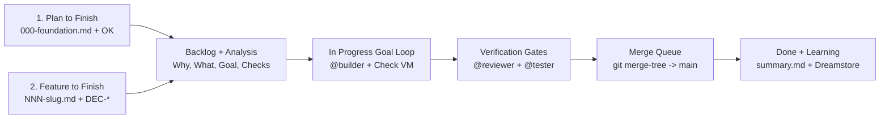
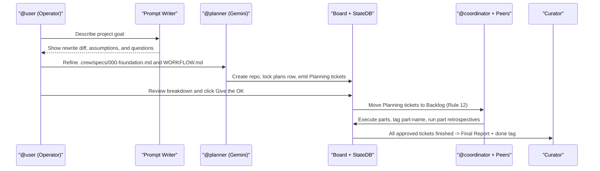
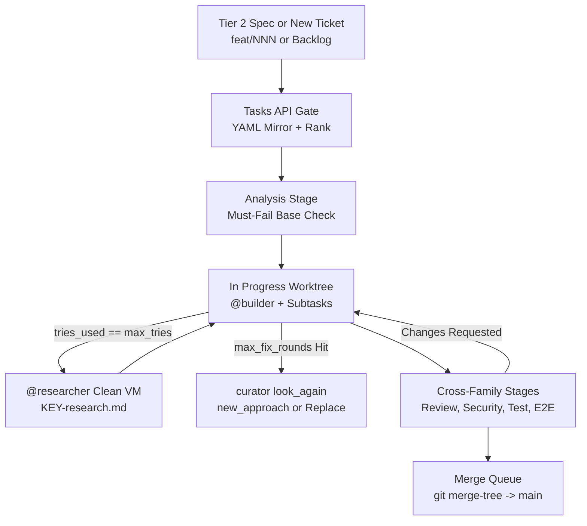
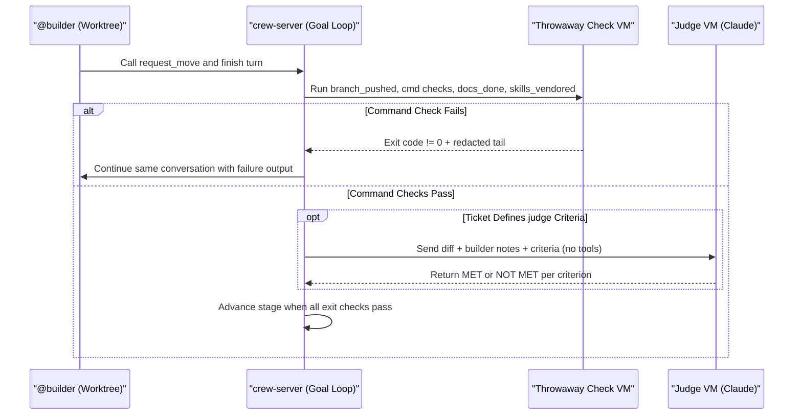
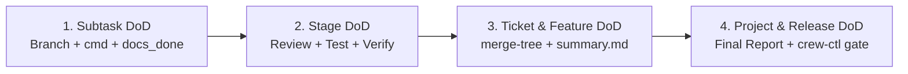

# Crew Workflow: From Plan and Feature to Done

Crew `2.0` governs software delivery as two connected pipelines backed by deterministic checks rather than agent self-reports (`Rule 2`). **Plan to Finish** takes an entire project from an initial prompt through **Give the OK** to a tagged `done` milestone and Final Report, while **Feature to Finish** drives each Tier 2 feature spec and ticket through **Analysis**, the **Goal Loop**, independent cross-family verification, and single-writer merges onto `main`.

---

## 1. Plan to Finish: Whole-Project Lifecycle

A project starts outside the code `Backlog` in **Plans**, locks its original scope once you click **Give the OK**, and advances through ordered parts until every approved ticket finishes and `curator` writes the Final Report (`Design 7.2`, `7.13`, `9.8`). You intervene only when a design alters `000-foundation.md`, touches `13.8` protected files, hits a project limit, or introduces an unrequested feature.

Follow these eight lifecycle steps from initial concept to completed project:

1. **Refine your initial prompt (`internal/rewrite/`):** Before your first planning message reaches an agent, the Prompt Writer proposes a structured rewrite alongside your text, highlighting assumptions and up to three clarifying questions. You choose **Use the rewrite**, **Edit**, **Send mine**, or **Rewrite again**.
2. **Draft `.crew/specs/000-foundation.md` and `WORKFLOW.md`:** `@planner` (on Gemini, `Rule 15`) iterates on architecture, stages (`Review`, `Test`, `E2E`, `Verification`), and verification checks, saving immutable draft versions (`write_plan_draft`).
3. **Create the project and lock the plan (`6.6`, `7.2`):** Naming the project and ticket key creates its canonical and quarantine git repositories (`github` over SSH `:443` + `gh`, `existing`, or `local`), copies `baseline/WORKFLOW.md` onto `main`, and stores the original plan as immutable in `plans`.
4. **Generate the initial breakdown:** `@planner` divides the plan into ordered parts and tickets inside **Planning**, including an initial `docs` ticket that authors `README.md`, `docs/architecture.md`, and `docs/setup.md`.
5. **Click Give the OK (`Rule 12`):** Nothing enters execution before your approval. Clicking **Give the OK** atomically moves every ticket from **Planning** into **Backlog** and starts `@coordinator` scheduling.
6. **Complete parts with automatic retrospectives (`9.8`):** When every ticket of a plan part reaches `Done` or `cancelled` (with at least one `Done`), Crew tags `part-<name>` on that part's merge commit and schedules a `curator` retrospective to write `Dreamstore` entries and eval cases.
7. **Reach Project Done (`7.2`):** When zero approved tickets remain open or waiting in `Analysis`, Crew tags `done` on `main` and runs `curator` to write the five-section **Final Report** (built, skipped, cancelled, missing, and learned).
8. **Handle post-Done extensions and reverts (`7.13`):** Adding an operator ticket reopens execution with no new OK; submitting a **Plan Amendment** proposes new **Planning** tickets behind a fresh **Give the OK**; clicking **Revert** on any merged ticket opens a `revert` ticket running `git revert -m 1` through the same checks.

---

## 2. Feature to Finish: Spec and Ticket Lifecycle

Once a factory is running, individual capabilities flow either from Tier 2 Feature Specs (`.crew/specs/NNN-<slug>.md`) or directly from tracked tickets in `Backlog` (`Design 6.8`, `7.4`–`7.14`). Tickets move strictly to the right (`Rule 3`); failures trigger in-place fixes, clean-context `@researcher` diagnosis after `max_tries`, or `curator` replacement rather than moving cards backward.

Every feature and ticket follows seven backend-enforced stages from origination to merge:

1. **Originate a Tier 2 Feature Spec or ticket:** In `#<project>`, `@user` or any peer agent (`ask_planner` / `post_chat`) opens a `feat/<NNN>-<slug>` thread linked to `.crew/specs/NNN-<slug>.md`. Under `approvals.feature_specs: autonomous`, `@planner` resolves design questions within `max_agent_hops` (`3`), records searchable `DEC-*` rulings (`spec_decisions`), and triggers `@coordinator` to emit `.crew/tickets/<KEY>.md` YAML files into `Backlog`. Specs altering `000-foundation.md` scope or touching `13.8` protected paths escalate to **Inbox**.
2. **Enforce the Tasks API boundary (`R217`):** Code work (`feature`, `fix`, `chore`, `docs`, `revert`) enters `Backlog` as Kanban tickets, while non-code work (`spec`, `research`, `dream`, `coordinator`, `chat_action`) mints off-board `FactoryTask` (`<KEY>-T<N>`) records. Zero ACP sessions start without a Task ID (`TicketID != 0 || TaskID != ""`).
3. **Pass `Analysis` and baseline checks (`7.6`):** Ready `plan` or `operator` tickets with complete `why`, `what`, `goal`, and checks take a zero-LLM fast-path (`PurposeBase` check run on `main`). All agent-, chat-, token-, and conversation-created tickets require an LLM `curator` run (never by the ticket's creator, `Rule 4`) that sets `may_change`, `docs`, `skips` (never skipping `Review` for agent/chat origins), and decisions (`Approve`, `Skip`, `Discard`, or 24-hour `New feature` notice).
4. **Build in isolated worktrees (`In progress`):** `@builder` checks out `task/<KEY>-<slug>` inside the warm Kata microVM (`crew-proj-<project>`), runs project setup, and commits toward the goal. Independent work can split into parallel subtasks on `sub/<KEY>.<N>` branches restricted to declared `touches` files, which Crew merges and checks via a backend `join` subtask.
5. **Break failure loops with `@researcher` and `look_again` (`7.7`, `7.14`):** Hitting `max_tries` (default `3`) freezes WIP on `refs/crew/wip/<run>` and launches clean-context `@researcher` (reading only the ticket YAML, failing output, branch diff, and `Dreamstore`) to write `.crew/tickets/<KEY>-research.md` and recommend `retry_builder`, `ask_planner`, or `ask_user`. Exhausting `max_fix_rounds` triggers `curator` `look_again`, granting one `new_approach` (two extra fix rounds) or closing via `cancel_and_replace` (up to six replacement tickets tagged `replaces`).
6. **Pass independent verification stages:** Enabled optional stages execute in order—`Review` (`@reviewer`), custom `WORKFLOW.md` specialists (`@security`), `Test` (`@tester` + independent check VM), `E2E` (`e2e` + check VM), and `Verification` (`verifier`). Code and verification judging run on Anthropic (`claude`) models when `3p` quota allows (`Rule 15`); failed checks add a `fix` subtask in the same stage without moving the card backward.
7. **Land via single-writer Merge Queue (`7.10`):** When all enabled stages approve, `crew-server` builds a candidate merge tree (`git merge-tree`) against `main` containing `CHANGELOG.md` and `docs/decisions/NNNN-*.md`, runs every ticket and project command check inside a throwaway check microVM, retries once if flaky, advances `main`, syncs GitHub pull requests, updates `Dreamstore` validity, and generates `summary.md`.

---

## 3. Goal Contract, Must-Fail Checks, and the Goal Loop

In Crew, a **Goal** is not prose advice; it is an enforceable four-part contract evaluated by deterministic commands and independent judges (`Design 7.1`, `11.3`). No ticket enters `In progress` until its goal-proving checks fail against current `main`, proving the checks actually test missing behavior rather than passing vacuously.

### The Four-Part Task Contract

Every ticket must define four non-empty fields before leaving `Analysis` (`has_why_what_goal`, `has_check`).

| Field | Question Answered | Example (`SF-42`) |
| :--- | :--- | :--- |
| `why` | Why does this task exist in the plan or bug report? | Brute-force sign-in guesses must be rate-limited. |
| `what` | What changes in scope, and what is excluded? | Count consecutive failed sign-ins and lock for 15 minutes after 5 attempts; email alerts excluded. |
| `goal` | What observable behavior proves success when done? | Five invalid sign-ins trigger HTTP 429 lockout for 15 minutes. |
| `checks` | Which commands or `judge:` criteria verify the goal? | `go test -race ./internal/sessions/...` (`keeps: false`) |

### Must-Fail-First Baseline Verification (`PurposeBase`)

During `Analysis` approval, Crew spawns a throwaway check sandbox on `main` (`PurposeBase`) before `@builder` writes a line of code (`Design 7.1`, `7.6`):

- **Goal checks (`keeps: false`):** At least one command check on every ticket must **fail** on current `main`. If all goal checks already pass on `main`, Crew rejects the approval and forces `curator` to write a failing test or check specification.
- **Regression checks (`keeps: true`):** Existing project-wide checks (such as full test suites) carry `keeps: true` so they must keep passing both before and after the change.

### The In-Stage Goal Loop (`11.3`)

An agent's `request_move`, `fix_done`, or `subtask_done` MCP call never moves a ticket by itself; it hands control to the backend **Goal Loop** (`internal/runs/`, `internal/pipeline/`).

- **Bounded retries:** Failing exit checks continue the builder's same conversation (`session/load` or restored `cli_files`) up to `max_goal_rounds`. Exceeding `max_goal_rounds` stops the run, retries the subtask once, and escalates to `@researcher` or `look_again`.
- **Resilience across pauses:** If a run idles out while waiting for a long check or `judge:` sandbox, Crew resumes handling the completed turn automatically (`reportedDone`) instead of wasting a retry.

Reference: All 8 backend check types and test-file integrity guards (7.1)

| Check Kind / Name | Evaluated By | Pass Condition |
| :--- | :--- | :--- |
| `cmd: "<command>"` | Throwaway Check VM | Command exits `0` on the branch (`PurposeExit`, `PurposeTest`) or merge candidate (`PurposeMerge`). |
| `docs_done` | `internal/board/checks.go` | Every page listed in `ticket.docs` changed on the branch, or `docs_reason` is non-empty. |
| `skills_vendored` | `internal/board/checks.go` | Any branch modifying `.agents/skills/` has valid source URL, SHA pin, and licence rows in `VENDORED.md` (no symlinks). |
| `named_tests_kept` | `internal/board/testfiles.go` | Enforced when `Review` is off (except `revert` tickets): diff deletes no file named in any `cmd` check. |
| `review_verdict_approve` | `Review` stage | Latest review verdict is `approve` and justifies every modified or deleted test file (`*_test.go`, `test_*.py`, `*.spec.*`, `test/`). |
| `test_result_pass` | `Test` stage | Crew's own throwaway check sandbox pass on ticket checks + project test suite after `@tester` finishes. |
| `e2e_result_pass` | `E2E` stage | Crew's own check sandbox pass running `e2e` flow with logs and screenshots attached. |
| `verify_pass` | `Verification` stage | Cross-family `verifier` verdict confirming output meets `goal` and source plan. |
| `judge: "<criterion>"` | `task_judge_checks_pass` | Toolless cross-family judge reads diff + builder note (up to 10 criteria) and marks every criterion `MET`. |

---

## 4. Definition of Done (DoD)

**Definition of Done** in Crew is an immutable ladder of backend-verified gates across four nested scopes (`Design 7.4`, `7.10`, `9.9`, `16.2`, `AGENTS.md`). Every check runs against isolated git trees inside throwaway or cross-family sandboxes before `crew-server` advances a stage, writes `main`, or accepts a Crew self-update.

### 1. Subtask and In-Progress DoD

A build or fix subtask is complete only when all code, documentation, and security gates hold on its quarantine branch (`internal/settings/board.yaml`, `internal/board/checks.go`):

- **Branch & push bounds:** `branch_pushed` and `has_commits` confirm commits exist ahead of `main` on `task/<KEY>-<slug>` (or `sub/<KEY>.<N>` joined into `task/*`), touching only paths allowed by `analysis.may_change` and passing `internal/gitendpoint` `pre-receive` limits (UTF-8, commit/tree size caps, no symlink escapes).
- **Check & test integrity:** `task_cmd_checks_pass` exits `0` inside a fresh check VM, `named_tests_kept` verifies no command-check test file was deleted when `Review` is off, and `task_judge_checks_pass` confirms all `judge:` criteria are `MET`.
- **Docs, skills & notes:** `note_exists` records the builder's handoff note, `docs_done` verifies every listed doc page updated on the branch (or carries a valid `docs_reason`), and `skills_vendored` enforces `VENDORED.md` pins and `13.8` operator holds if instruction files changed.

### 2. Verification Stage DoD (Review, Security, Test, E2E, Verification)

Every enabled verification stage adds independent proof before a ticket enters the Merge Queue:

- **Cross-family Review (`review_verdict_approve`):** `@reviewer` (on Anthropic `claude` when `3p` quota permits, `Rule 15`) reads the diff against `goal` and docs, explains why any modified/deleted test file is valid, and issues `approve`. Custom `WORKFLOW.md` specialists (`@security`, `stage_verdict_pass`) load strictly from canonical `main` (`13.8`).
- **Independent Test & E2E execution (`test_result_pass`, `e2e_result_pass`):** Crew ignores self-reported agent test claims (`Rule 2`) and executes the project's test command and E2E suite itself inside a throwaway check sandbox.
- **Final Verification (`verify_pass`):** `verifier` (cross-family) confirms the combined branch satisfies both the ticket's `goal` and its originating plan/spec contract.

### 3. Ticket and Feature DoD (Merge to `main`)

A ticket reaches **Done** (`merges_and_passes_on_main`), and a Tier 2 Feature Spec completes, only when all integration and post-merge bookkeeping finishes (`7.10`, `9.9`):

- **Exact-head review currency (`review_covers_head`):** If any fix commit landed after `Review` approved, or if the branch touches package files (`13.8`), Crew requires a fresh `@reviewer` approval on the exact final head SHA before merging.
- **Atomic candidate merge (`git merge-tree` + `PurposeMerge`):** `crew-server` creates a merge candidate commit on `main` (embedding the `CHANGELOG.md` entry and any `docs/decisions/NNNN-*.md` pages), passes every ticket and project test inside a throwaway check VM (with one automatic retry on flaky failure), advances `main`, and pushes/closes any linked GitHub pull request.
- **Post-merge records:** Crew re-indexes `docs/` (`IndexDocs`, flagging any code-behind doc pages), updates `Dreamstore` `validity_score` (`PassBoost` / `DriftPenalty`), and generates the ticket's `summary.md` (`tokens`, `minutes_in_stage`, `commits`, `led_to`).
- **Feature Spec closure:** A Tier 2 `.crew/specs/NNN-<slug>.md` feature is done when all open questions and `DEC-*` rulings are resolved (`spec_decisions`), any `13.8` / `000-foundation.md` escalations are approved by `@user`, and all emitted `.crew/tickets/<KEY>.md` tickets reach `Done` (or closed).

### 4. Project and Release Gate DoD

Whole-project completion and self-hosted Crew upgrades apply their own terminal gates (`7.2`, `16.2`, `AGENTS.md`):

- **Project Done:** Every approved ticket is `Done`, `cancelled`, `skipped`, or `discarded`; part and final retrospectives finish; `done` is tagged on `main`; and `curator` writes the five-section Final Report (`write_report`).
- **Crew Repository & Release Gate (`AGENTS.md`, `16.2`):** Code changes in Crew itself pass `make check` (Go `-race` unit/integration tests against throwaway PostgreSQL, web TypeScript + Vitest suite, `50` firewall namespace cases, Compose check, `tools/check-versions.py`, `tools/plan-copies.py --check`, `spike/scrub.py`, and `tools/check-clean.py`), followed by `sudo deploy/crew-ctl gate <version>` (scratch-DB migration check, smoke microVM, real `GateTicket` on `crew-gate`, release evals, and a 10-minute post-swap health watch with automatic rollback).

Reference: Complete stage-by-stage entry, role, model family, and exit DoD matrix

| Stage | Optional / Default | Assigned Role & Family | Entry Condition | Exit / DoD Checks |
| :--- | :--- | :--- | :--- | :--- |
| `planning` | Fixed (On) | `@planner` (Gemini) | Breakdown generated from `000-foundation.md` | Operator clicks **Give the OK** (`Rule 12`) |
| `backlog` | Fixed (On) | `@coordinator` (Gemini) | Plan OK given, spec emitted, or ticket created | Prioritized; `Analysis` WIP slot available |
| `analysis` | Fixed (On) | `curator` (Gemini) or Zero-LLM Fast-Path | Pulled from `Backlog` | `has_why_what_goal`, `has_check`, `analysis_approved`, `PurposeBase` check fails on `main` |
| `in_progress` | Fixed (On) | `@builder` (Gemini) | `dependencies_done` | `branch_pushed`, `has_commits`, `note_exists`, `task_cmd_checks_pass`, `task_judge_checks_pass`, `docs_done`, `skills_vendored`, `named_tests_kept` (if Review off) |
| `review` | Optional (On) | `@reviewer` (Anthropic `claude`) | Exited `In progress` | `review_verdict_approve` (test-file diffs justified) |
| Custom / Security | Optional (`WORKFLOW.md`) | Custom / `@security` (canonical `main`) | Preceding stage exited | `stage_verdict_pass` + configured stage checks |
| `test` | Optional (On) | `@tester` (Gemini) + Check VM | Preceding stage exited | `test_result_pass`, `task_checks_pass` |
| `e2e` | Optional (Off) | `e2e` (Gemini) + Check VM | Preceding stage exited | `e2e_result_pass` (logs + screenshots attached) |
| `verification` | Optional (Off) | `verifier` (Anthropic `claude`) | Preceding stage exited | `verify_pass` against `goal` and source plan |
| `done` | Fixed (Terminal) | Backend (`crew-server`) + `summary` | `review_covers_head` + `merges_and_passes_on_main` | `git merge-tree` + check VM pass -> `main` updated, `CHANGELOG.md`, `summary.md` |
| `closed` | Fixed (Terminal) | `curator` / Operator | Discarded or `cancel_and_replace` | Terminal (`replaces` / `replaced_by` links recorded) |

## Next steps

Explore the architectural guides and per-subsystem documentation that power every step of this workflow.

- Return to the installation and quick-start overview in [README.md](README.md).
- Browse all 10 subsystem visual guides in [Features Overview](docs/features/README.md).
- Dive deeper into [01. Two-Tier Planning and Feature Specs](docs/features/01-two-tier-planning-and-specs.md) and [02. Tasks API and Stage Pipeline](docs/features/02-tasks-api-and-stage-pipeline.md).
- Inspect the Go package boundaries behind the pipeline in [Architecture](docs/architecture.md).
