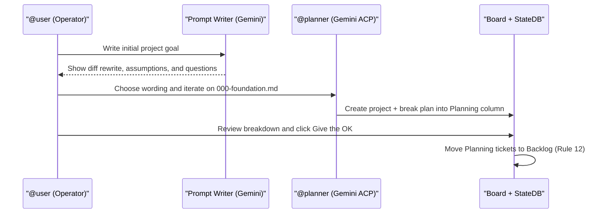
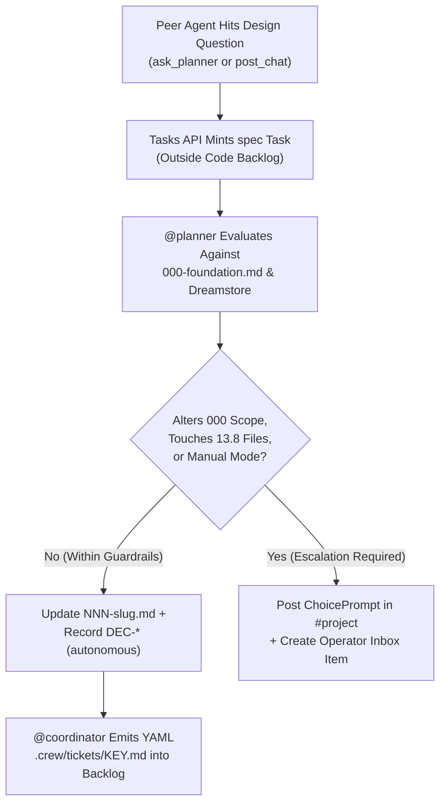

# Two-Tier Planning and Feature Specs

Crew separates strategic project alignment from day-to-day execution by splitting planning into two tiers outside the code `Backlog`. You approve the initial Tier 1 foundation and `WORKFLOW.md` once with **Give the OK**; afterward, Tier 2 feature specs converge either interactively with you or autonomously between peer agents and `@planner` before `@coordinator` emits executable YAML tickets.

## Tier 1: Foundation Planning (`000-foundation.md`)

Tier 1 establishes your repository's contract, architecture boundaries, and workflow topology before any code ticket enters `Backlog`. The planning service (`internal/planning/`) and prompt writer (`internal/rewrite/`) collaborate with you in **Plans** to refine `.crew/specs/000-foundation.md` and initial `WORKFLOW.md`.



1. **Refine the prompt:** Before your first message sends, the prompt writer (`internal/rewrite/`) shows a word-level diff rewrite with assumptions and clarifying questions so you can accept, edit, or send your own text.
2. **Draft and break down:** `@planner` (always on Gemini unless pinned, `Rule 15`) maintains versioned plan drafts (`write_plan_draft`) and generates `.crew/specs/000-foundation.md`, `WORKFLOW.md`, and initial tickets in the **Planning** column.
3. **Give the OK (`Rule 12`):** Agents cannot start building until you explicitly click **Give the OK** on the project board, ensuring zero autonomous compute burns on an unapproved foundation.

## Tier 2: Autonomous Feature Specs (`NNN-<slug>.md`)

Once the factory is running, any feature addition or design question uses `.crew/specs/NNN-<slug>.md` without forcing you to write every intermediate ticket by hand. Peer agents (`@builder`, `@coordinator`, `@researcher`, `@reviewer`, `@dreamer`) or `@user` open a feature thread (`feat/<NNN>-<slug>`) inside `#<project>` and collaborate with `@planner`.



- **Default autonomous policy:** `approvals.feature_specs: autonomous` (declared in `WORKFLOW.md` and `board.yaml`) lets `@planner` resolve scoped ambiguities within `max_agent_hops` (default `3`).
- **Auditable decision ledger (`spec_decisions`):** Every autonomous or human choice creates a searchable `DEC-*` row recording `decided_by` (`autonomous (@planner + <asking_peer>)` or `operator`), `provenance` (`direct` or `agent_interpreted`), alternatives considered, and rationale (`internal/board/spec_decisions.go`).
- **One-click override:** You can inspect all feature specs and `DEC-*` rulings in **Specs & WORKFLOW** (`web/src/routes/p.$project.specs.tsx`) and override any decision directly.

## Escalation Guardrails and `WORKFLOW.md` Custody

Crew treats `WORKFLOW.md` and protected harness instructions as security boundaries under Design Section `13.8`. The backend reads `WORKFLOW.md` strictly from canonical `main` (`internal/board/workflow.go`), refusing git symlinks and ignoring unmerged branch edits.

- **Foundation drift:** Any feature spec flagged with `altersFoundation: true` pauses and escalates to **Inbox** for your approval.
- **Protected file guard (`13.8`):** If a spec or task touches `WORKFLOW.md`, `.agents/skills/`, `.agents/rules/`, or `.github/workflows/`, Crew holds execution and sends the exact diff to your **Inbox** behind a fresh sign-in check (`Rule 13`).
- **Manual approval mode:** Projects setting `approvals.feature_specs: manual` require explicit operator confirmation before `@coordinator` emits tickets from any `NNN-<slug>.md` spec.

<details>
<summary>Reference: WORKFLOW.md frontmatter contract and DEC-* decision fields</summary>

```yaml
---
version: 1
project: "storefront-api"
key: "SF"
harness: agy
max_tries: 3
max_agent_hops: 3
approvals:
  feature_specs: autonomous   # autonomous | manual
  workflow_edits: operator
roles:
  planner: "@planner"
  coordinator: "@coordinator"
  builder: "@builder"
  reviewer: "@reviewer"
  security: "@security"
  researcher: "@researcher"
  tester: "@tester"
  dreamer: "@dreamer"
stages:
  - backlog
  - in_progress
  - review
  - verify
  - done
---
```

| Field | Package / Table | Purpose |
| :--- | :--- | :--- |
| `tier` | `specs` (`foundation` \| `feature`) | Separates operator-gated `000-foundation.md` from Tier 2 `NNN-<slug>.md` specs |
| `approval_mode` | `specs` (`autonomous` \| `manual`) | Controls whether `@planner` can approve scoped specs without `@user` |
| `decided_by` | `spec_decisions` | Records operator or `autonomous (@planner + @peer)` attribution |
| `provenance` | `spec_decisions` (`direct` \| `agent_interpreted`) | Distinguishes 1-click UI choices from prose-interpreted answers |
| `emitted_keys` | `specs` | Lists `.crew/tickets/<KEY>.md` tickets emitted by `@coordinator` into `Backlog` |

</details>

## Next steps

Follow the execution pipeline and `#<project>` chat workflows to see how approved specs turn into delivered code.

- Learn how emitted tickets execute in [02. Tasks API and Stage Pipeline](02-tasks-api-and-stage-pipeline.md).
- Read how `@planner` and peer specialists deliberate inside `#<project>` threads in [04. Project Chat and Choice Prompts](04-project-chat-and-choice-prompts.md).
