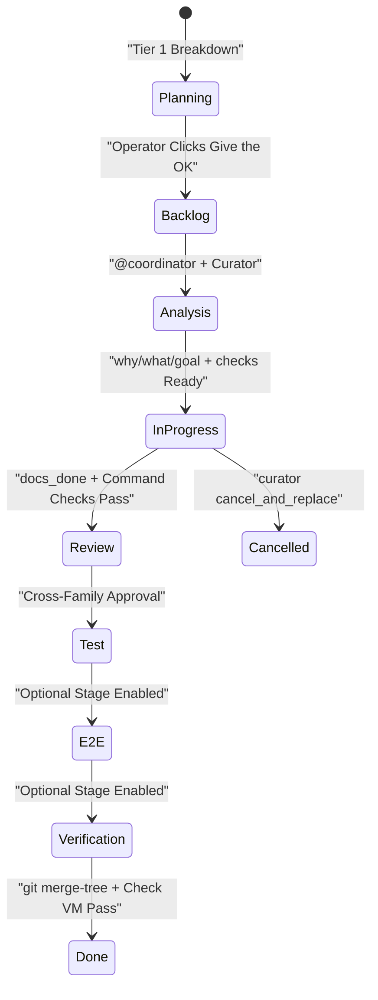
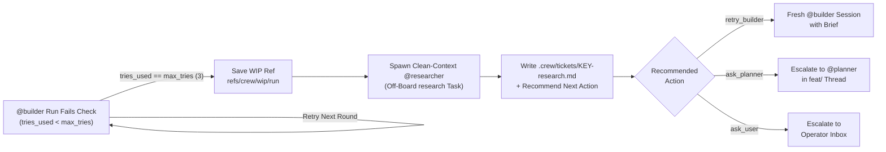

# Tasks API and Stage Pipeline

Zero agent compute executes in Crew without a tracked work boundary registered through the **Tasks API** (`internal/board/factory_tasks.go`). Executable code work (`feature`, `fix`, `chore`, `docs`, `revert`) moves strictly left-to-right across Kanban stages on isolated git branches, while non-code work (`spec`, `research`, `dream`, `coordinator`, `chat_action`) runs as off-board `FactoryTask` records linked to the same token ledger and Trajectory Store.

## Tasks API Pre-Compute Gate (`R217`)

Every agent run must bind to either a Kanban ticket (`tickets`) or an off-board `FactoryTask` (`<KEY>-T<N>`) before `Agent API` spawns a session (`internal/runs/agent_sessions.go`). This closes untracked background compute paths and guarantees every token spent links to a YAML contract, sandbox ID, and trajectory.

- **Code Kanban tickets (`.crew/tickets/<KEY>.md`):** Synchronized from canonical `main` (`SyncTicketsFromMain`) for `feature`, `fix`, `chore`, `docs`, and `revert` tasks. Attempting to push a non-executable kind into `.crew/tickets/` is rejected fail-closed (`validateExecutableMirrorKinds`).
- **Off-board `FactoryTask` units:** Track `spec` planning, `research` circuit-breaker investigations, `dream` passes, `coordinator` scheduling, and `chat_action` turns outside the code board with explicit `tries_used / max_tries`, `budget_tokens`, and `artifact_path`.

## Right-Only Kanban Stage Pipeline

Code tickets move strictly from left to right; Crew never reopens a `Done` ticket or moves a card backward (`Rule 3`). Failures are fixed forward in place by the builder or replaced via `look_again`.



1. **Backlog (`@coordinator`):** `@coordinator` ranks ready tickets by `depends_on`, spec order, risk, and blocked retries, keeping dependency cycles blocked via `link_tickets`.
2. **Analysis (`curator`):** Sets `why`, `what`, `goal`, `may_change`, `docs` pages, and verification `checks`. A ticket created by an agent must be analyzed by a different agent role (`Rule 4`), and `Review` cannot be skipped on agent-created or chat-drafted tickets.
3. **In progress (`@builder` & Parallel Subtasks):** Runs on `task/<KEY>-<slug>`. When a build splits into independent parts, parallel subtasks work on `sub/<KEY>.<N>` branches restricted to declared `touches` files, then merge via a backend `join` subtask verified in a throwaway check sandbox.

## `max_tries` Circuit Breaker and `look_again`

When a build or fix agent stalls repeatedly, Crew stops burning tokens on polluted context and switches to clean-context diagnosis (`internal/board/research_briefs.go`, `internal/board/lookagain.go`).



- **Clean-context `@researcher`:** Receives only the ticket YAML (`why`, `what`, `goal`), failing check output, branch diff against `main`, and high-validity `Dreamstore` entries—never the failing builder's noisy conversation history.
- **`curator` `look_again`:** If a ticket exhausts `max_fix_rounds` or its runs stop twice for countable reasons, `curator` grants either one `new_approach` (with two additional fix rounds) or closes the ticket via `cancel_and_replace` (emitting up to six smaller replacement tickets tagged with `replaces`).

## Single-Writer Merge Queue and GitHub Sync

Sandboxes never push to `main` or merge pull requests (`Rule 2`, `Rule 4`). Only `crew-server` writes `main` one ticket at a time under a per-project lock.

- **Candidate merge without worktrees:** Crew runs `git merge-tree` between `main` and the task branch inside the canonical bare repository, embedding the ticket's `CHANGELOG.md` entry and `record_decision` pages into the candidate commit.
- **Throwaway check sandbox verification:** A fresh microVM runs the ticket checks and project test suite on the candidate tree. Transient command failures retry once and record a `flaky_check` signal if the retry passes.
- **Remote & PR sync:** When a GitHub remote and `gh` login exist, Crew pushes the task branch, mirrors verdicts and check statuses onto the pull request, pushes `main` after the candidate passes, and lets GitHub mark the PR merged automatically.

<details>
<summary>Reference: YAML ticket mirror schema (.crew/tickets/&lt;KEY&gt;.md) and subtask contract</summary>

```yaml
---
id: "42"
key: SF-42
title: Lock account after failed sign-in attempts
kind: feature              # feature | fix | chore | docs | revert
spec: SPEC-004             # linked Tier 2 feature spec (optional)
origin_room: "#storefront-api"
stage: in_progress         # planning | backlog | analysis | in_progress | review | test | e2e | verification | done | closed
priority: 2                # 0 urgent | 1 high | 2 normal | 3 low
depends_on: ["SF-40"]
max_tries: 3
tries_used: 1
assigned_agent: "@builder"
budget_tokens: 500000
why: "Limit brute-force sign-in guesses against operator sessions."
what: "Track consecutive invalid sign-in attempts and lock for 15 minutes after 5 tries."
goal: "Five failed sign-ins trigger HTTP 429 lockout for 15 minutes."
checks:
  - kind: cmd
    spec: "go test -race ./internal/sessions/..."
analysis:
  status: ready
  may_change: ["internal/sessions/**"]
---
```

| Work Unit | Table / Path | Lifecycle States | Purpose |
| :--- | :--- | :--- | :--- |
| Executable Ticket | `tickets` + `.crew/tickets/<KEY>.md` | `planning` -> `backlog` -> `analysis` -> `in_progress` -> `review` -> `test` -> `e2e` -> `verification` -> `done` / `closed` | Tracks code changes through isolated task branches and merge queue |
| Off-Board `FactoryTask` | `factory_tasks` (`<KEY>-T<N>`) | `queued` -> `running` -> `done` / `failed` / `cancelled` | Tracks `spec`, `research`, `dream`, `coordinator`, and `chat_action` compute |
| Subtask | `subtasks` (`<KEY>.<N>`) | `queued` -> `running` -> `waiting` -> `done` / `failed` / `cancelled` | Tracks individual agent runs (`build`, `review`, `test`, `part`, `join`, `look_again`) |
| Research Brief | `research_briefs` + `.crew/tickets/<KEY>-research.md` | Recommended: `retry_builder` \| `ask_planner` \| `ask_user` | Captures clean-context root-cause diagnosis when `tries_used == max_tries` |

</details>

## Next steps

Continue to the agent execution layer and sandbox runtime guides to see how tracked tickets execute and pass verification checks.

- See how peer agent sessions execute and select models in [03. Agent API and Peer Specialists](03-agent-api-and-peer-specialists.md).
- Inspect how project sandboxes isolate branches and run check VMs in [05. Sandboxes and ComputeRuntime](05-sandboxes-and-compute-runtime.md).
