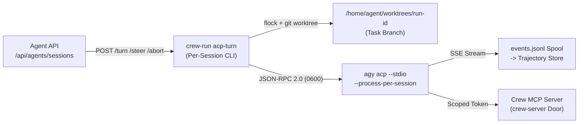
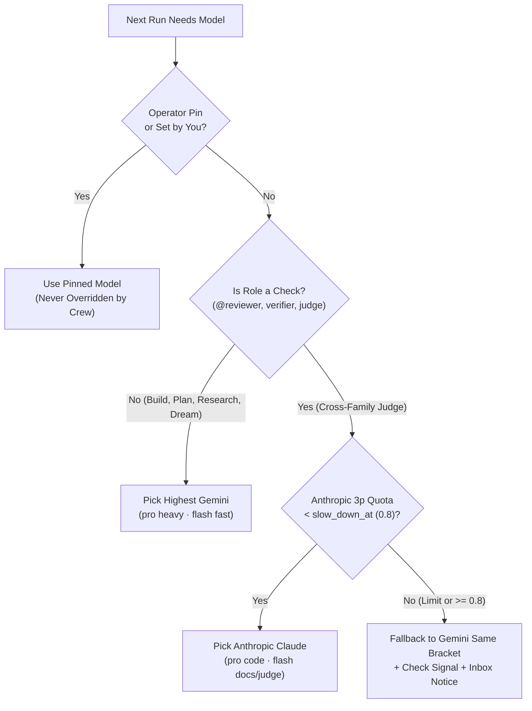

# Agent API and Peer Specialists

Crew replaces nested black-box subagents with an explicit **Agent API** (`internal/runs/agent_sessions.go`, `internal/httpapi/agent_api.go`) where every peer agent runs its own persistent `agy acp --stdio --process-per-session` session inside the project's warm microVM. You steer, pause, inspect, or abort any specialist independently while `Rule 15` routes construction roles to Gemini and independent verification roles to Anthropic (`claude`) models.

## Multi-Session ACP Control Plane (`1 session = 1 peer agent`)

Inside each warm project microVM (`crew-proj-<project>`), `crew-run acp-daemon` hosts a local JSON-RPC 2.0 ACP server over `/run/crew/acp.sock` (`0600`) with `agy`'s internal CLI subagent tools disabled (`SubagentsDisabled() == true`). Every peer role gets an isolated git worktree (`/home/agent/worktrees/<run-id>`) and scoped MCP token bound to a tracked `Tasks API` work unit.

- **Lifecycle endpoints:** `POST /api/agents/sessions` spawns a session (rejecting untracked `TicketID == 0 && TaskID == ""` requests), `/turn` dispatches work, `/steer` injects `@user` mid-turn interrupts, `/abort` cancels cleanly (`acp-cancel`), and `/stream` pushes live ACP events over SSE.
- **Spool-backed resilience:** `crew-run` writes events to `events.jsonl` on the host-mounted run directory and updates `heartbeat` every 10 seconds, so a restart of `crew-server` never loses running agent output.
- **CLI adapter seam (`internal/cli/adapter.go`):** `cli.Names()` stays locked to `agy` while keeping `ACPAdapter`, `IsolationDedicatedKataVM`, `0600` OAuth `AuthSpec`, and `MultiProviderForbiddenEnv` ready for future `pi` or `claude` adapters.

## Built-In Peer Roster and Custom `WORKFLOW.md` Specialists

Crew divides the retired `lead` role into `@planner` (specs and breakdowns) and `curator` (backlog analysis, `look_again`, housekeeping, and final reports), alongside dedicated execution, checking, and dreaming peers. You can also declare bounded custom specialists in canonical `main` `WORKFLOW.md` (with `slug`, `promptFile`, `modelBracket`, `readOnly`, `docker`, and `skills[]`).

- **Built-in peers:** `@planner`, `@coordinator`, `curator`, `@builder`, `@researcher`, `@reviewer`, `@security`, `@tester`, `e2e`, `verifier`, `judge`, `@dreamer`, `summary`, `prompt`, `assistant`, and `improver`.
- **Fail-closed specialist bounds:** Custom specialist definitions are read strictly from canonical `main` (`13.8`), refuse symlinks, default to Gemini models (`Rule 15`), and never widen network or credential permissions.

## Model Family Policy (`Rule 15`) and Quota Routing

Crew never hardcodes model catalogs; on startup and login checks (`models.Record`), it classifies models offered by `agy` into `pro`, `flash`, and `oss` brackets (`agents.brackets`) and ranks entries deterministically by `(version DESC, first_seen DESC)`.

- **Strict family separation:** `@planner`, `@coordinator`, `@builder`, `@researcher`, `@tester`, `@dreamer`, `curator`, `assistant`, `summary`, `prompt`, and `improver` run exclusively on Gemini unless you explicitly pin another model.
- **Cross-family verification:** Code-ticket `@reviewer`, `verifier`, and custom stage checks run on Anthropic `pro` models (`docs`/`chore` reviews and `judge:` checks use Anthropic `flash`). When the `3p` quota group hits its limit or `quota.slow_down_at` (`0.8`), checks fall back to the matching Gemini bracket and record `check_rule_not_met` in **Inbox**.
- **Automatic promotions with rollback:** For automatic roles (`builder`, `reviewer`, `tester`, `e2e`, `verifier`), Crew watches newer offered models (`reason = "newer"`) over `watch_runs` (`20`) and rolls back automatically for 30 days if pass rates drop or escaped defects rise (`12.3`).

## Unified Scheduler Queue and Conversation Continuation

All runs share one deterministic scheduler queue (`lead_waits`) bounded by `max_concurrent_runs` (`8` default, halved when a model group passes `quota.slow_down_at`) and machine CPU/memory capacity (`internal/capacity/`).

1. **Interactive reservation:** Keyboard turns (`operator_waiting` in plans and `#<project>` chat) bypass background ticket contention up to `conversations.max_sandboxes` (`3`).
2. **Deterministic ticket priority:** Resuming `continues` runs go first (preventing post-check deadlocks), followed by stage furthest right (`Verification -> Analysis`), operator priority (`urgent` to `low`), least recently served project, ticket priority, and age before low-priority maintenance (`housekeeping`, `retrospective`, `evals`, `improvement`).
3. **Three-way continuation (`12.10`):** When a conversation continues across turns, Crew uses (1) warm microVM `session/load`, (2) sealed `cli_files` restored from `StateDB` with `STEP_TYPE_ERROR` trajectories stripped, or (3) a rebuilt `"The conversation so far"` prompt summarizing earlier turns.

Reference: Built-in peer specialist roster and default Rule 15 routing (16 roles)

| Role | Default Family | Default Bracket | Worktree / Mode | Primary Responsibility |
| :--- | :--- | :--- | :--- | :--- |
| `@planner` | Gemini | `pro` | Read-only / Model | Drafts `000-foundation.md` and resolves Tier 2 `NNN-<slug>.md` feature specs |
| `@coordinator` | Gemini | `pro` | Read-only | Ranks `Backlog`, emits ticket YAML contracts, and coordinates factory dispatch |
| `curator` | Gemini | `pro` | Read-only | Analyzes tickets, runs `look_again`, housekeeping, retrospectives, and final reports |
| `@builder` | Gemini | `pro` (`flash` on `docs`/`chore`/`part`) | Read-write `task/*` | Implements code, tests, and docs on isolated git worktrees |
| `@researcher` | Gemini | `pro` | Clean-context `mdl-*` | Diagnoses `max_tries` failures and writes `<KEY>-research.md` |
| `@reviewer` | Anthropic (`claude`) | `pro` (`flash` on `docs`/`chore`) | Read-only (`main` rules) | Cross-family code and doc review; emits `approve` or `changes_requested` |
| `@security` | Gemini / `WORKFLOW.md` | `pro` | Read-only (`main` rules) | Defensive diff and blast-radius security inspection |
| `@tester` | Gemini | `flash` | Read-only | Validates test coverage and failure cases against acceptance criteria |
| `e2e` | Gemini | `flash` | Read-only + Browser | Runs end-to-end verification in browser/app sandboxes |
| `verifier` | Anthropic (`claude`) | `pro` | Read-only | Independent cross-family final verification before merge |
| `judge` | Anthropic (`claude`) | `flash` | `mdl-*` | Evaluates `judge:` checks and eval fit checks |
| `@dreamer` | Gemini | `pro` | Read-only `tasks` | Synthesizes scoped context edits and `SKILL.md` proposals (`10.8`) |
| `assistant` | Gemini | `pro` | Read-only sandbox | Answers operator questions in `#<project>` or legacy ticket chats |
| `prompt` | Gemini | `flash` | `mdl-*` | Rewrites and reviews operator draft text (`internal/rewrite/`) |
| `summary` | Gemini | `flash` | `mdl-*` | Writes structured `summary.md` after a task reaches `Done` or closes |
| `improver` | Gemini | `pro` | Global `mdl-*` | Proposes scrubbed generic baseline patches across all projects (`10.4`) |

## Next steps

Explore how peer specialists communicate across feature threads and how warm Kata microVMs isolate every ACP worktree.

- See how peer specialists coordinate in `#<project>` channels in [04. Project Chat and Choice Prompts](04-project-chat-and-choice-prompts.md).
- Read how warm microVMs isolate every ACP worktree in [05. Sandboxes and ComputeRuntime](05-sandboxes-and-compute-runtime.md).
