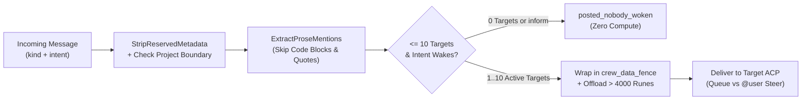
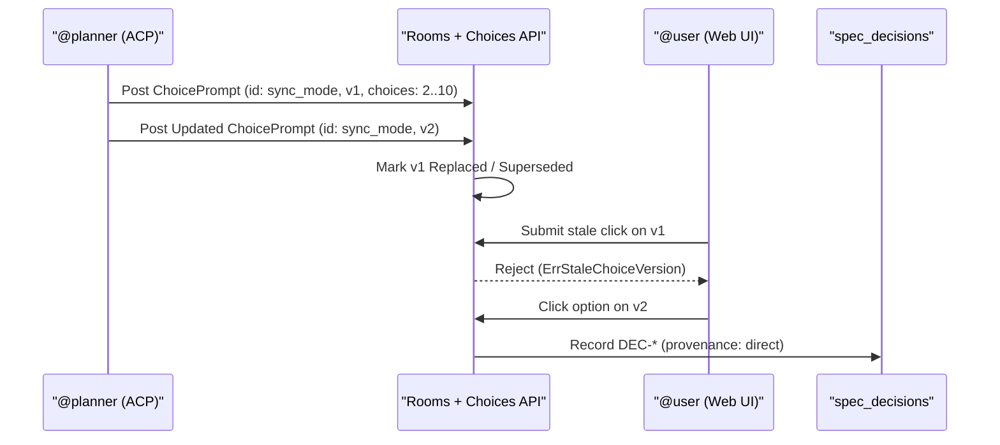

# Project Chat and Choice Prompts

Every project factory provides one canonical `#<project>` channel and one thread per feature (`feat/<NNN>-<slug>`) where you and peer agents collaborate openly (`internal/rooms/`). Strict CommonMark mention parsing, provenance fencing, queue-by-default turns, and versioned `ChoicePrompt` cards keep multi-agent chatter deterministic, bounded, and safe against prompt injection (`Rule 14`).

## Channel Model and CommonMark Mention Routing

Instead of splitting work across hidden 1:1 chats, `#<project>` collects factory-wide queue updates, `@dreamer` proposals, and `Knowledge API` advisories while `feat/<NNN>-<slug>` threads group each `SPEC-NNN` with its child `<KEY>` tickets.



- **Code-aware `@mention` parsing (`internal/rooms/mentions.go`):** `ExtractProseMentions` extracts unique normalized `@handles` from prose only—ignoring `@tokens` inside fenced code blocks, inline code spans, and `>` blockquote lines—and rejects messages exceeding `MaxMentionRecipients` (`10`).
- **Orthogonal envelope (`kind` and `intent`):** Every message pairs `kind` (`text`, `event`, `choice_prompt`, `choice_response`) with `intent` (`inform`, `request`, `question`) and records per-addressee delivery status (`pending`, `queued`, `delivered`, `suppressed`, `failed`) in `chat_message_addressees`.
- **Zero-compute no-op feedback:** Writing a message with `intent: inform` or zero `@mentions` updates the thread immediately with `"Posted to room; nobody woken."` without spawning an ACP session.

## Turn Delivery, `@user` Steer, and Safety Bounds

Crew protects active peer turns from cross-agent interruption and prevents runaway reply loops or oversized context bloat (`internal/rooms/offload.go`, `internal/fence/`).

- **Queue-by-default vs `@user` interrupt (`steer`):** Routine chat deliveries targeting a busy peer session enqueue cleanly for the next turn (`ErrBusy` -> `queued`). Only `@user` can enable **Interrupt active turn now** (`steer`), injecting directly via `crew-run acp-steer`.
- **Hop cap (`max_agent_hops`):** Peer-to-peer wakes increment `hop_count` and stop automatically at `max_agent_hops` (default `3` per trigger), notifying you if further input is needed.
- **Provenance fencing (`<crew_data_fence>`):** Peer messages enter agent prompts wrapped in `<crew_data_fence>` headers naming sender role, handle, co-addressees (`to="..."`), and untrusted-data framing (`Rule 14`), with `StripReservedMetadata` stripping spoofed keys on ingress.
- **Large-body agent offload:** Full bodies stay searchable in `StateDB` and readable in the web UI, but deliveries exceeding `OffloadThresholdRunes` (`4000` runes) pass a UTF-8 `768`-byte preview, SHA-256 digest, and `read_chat(messageId=...)` fetch hint to agents.

## Keyed Versioned `ChoicePrompt` Cards

When an agent or `@planner` needs a concrete decision, it posts a structured `ChoicePrompt` card (`internal/rooms/choices.go`) rendered as interactive buttons in `#<project>` and **Inbox**.



- **Atomic versioning (`v1 -> v2`):** Re-posting the same `choicePrompt.id` increments `version` under a row lock (`FOR UPDATE`), marks earlier cards `Superseded`, and rejects stale submissions with `ErrStaleChoiceVersion`.
- **Explicit provenance tracking:** Clicking a button records `provenance: direct`; when a peer interprets free-form prose back to a prompt card, it records `provenance: agent_interpreted` with mandatory `sourceMessageId` so you can verify or override it with one click.

<details>
<summary>Reference: Chat message envelope, ChoicePrompt schema, and MCP chat tools</summary>

```json
{
  "id": "sync_mode",
  "version": 2,
  "update": true,
  "question": "How should skills sync to paused project microVMs?",
  "choices": [
    { "id": "lazy", "label": "Lazy sync on UnpauseSandbox" },
    { "id": "eager", "label": "Wake VM and sync immediately" }
  ],
  "default": "lazy",
  "specRef": "SPEC-004"
}
```

| Mechanism | Package / Constant | Limit / Contract |
| :--- | :--- | :--- |
| Mention extraction | `internal/rooms/mentions.go` (`MaxMentionRecipients`) | `10` active recipients max; prose only |
| Body offload | `internal/rooms/offload.go` (`OffloadThresholdRunes`) | `> 4000` runes offloaded to `768`-byte preview + `read_chat` |
| Loop cap | `WORKFLOW.md` (`max_agent_hops`) | Default `3` peer-to-peer hops per trigger |
| Choice card bounds | `internal/rooms/choices.go` (`MaxChoicePromptBytes`) | `2..10` options, `<= 2000`-rune question, `<= 32 KiB` payload |
| Agent MCP chat tools | `baseline/tools.yaml` | `post_chat`, `read_chat`, `ask_planner`, `respond_choice_prompt` |

</details>

## Next steps

Trace how `#<project>` threads link into feature specifications and the interactive web interface.

- Review how `#<project>` threads link back to specs and `DEC-*` rulings in [01. Two-Tier Planning and Feature Specs](01-two-tier-planning-and-specs.md).
- Explore the live Chat Rooms UI and mobile `VisualViewport` support in [08. Visual Control Plane and 40 Themes](08-visual-control-plane-and-themes.md).
