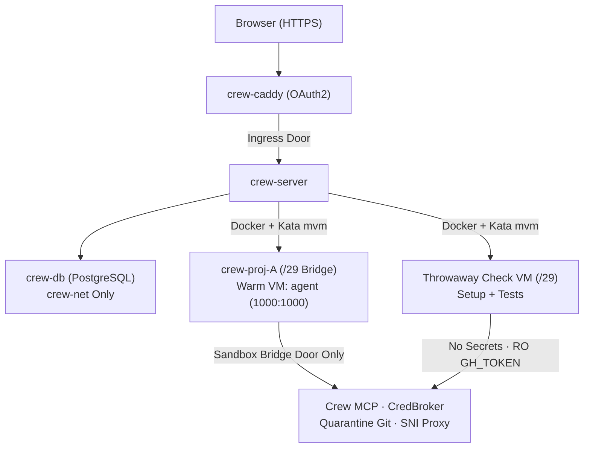
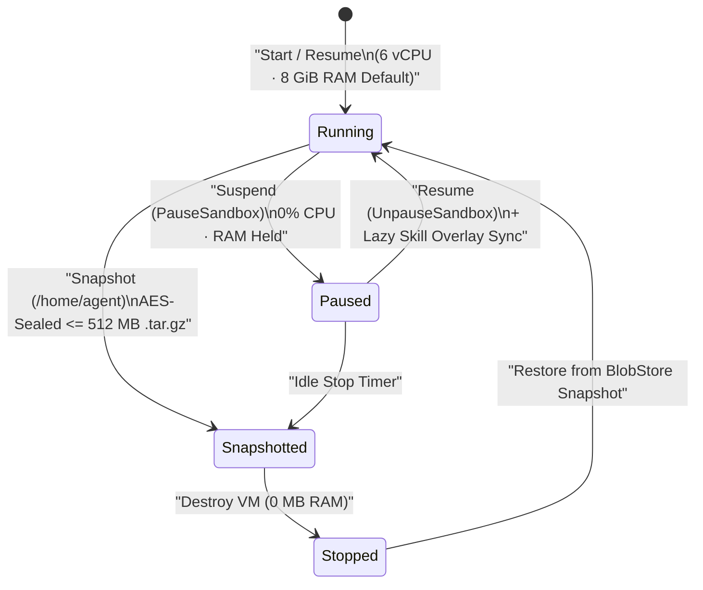

# Sandboxes and ComputeRuntime

Every agent turn, command check, browser terminal, and hosted application runs inside its own hardware-isolated **Kata Containers microVM** (`--runtime mvm`, Cloud Hypervisor) on a dedicated `/29` network bridge (`internal/sandboxes/`, `internal/orchestrator/`). Crew separates warm persistent-home project VMs from throwaway check sandboxes, denies cross-sandbox and LAN routes via `iptables`, and keeps SSH keys, `gh` logins, and encryption keys exclusively on the server (`Rules 1, 5, 6, 7, 8, 11`).

## Host Isolation and the Two Server Doors

Crew's network topology guarantees that untrusted agent code cannot reach PostgreSQL (`crew-db`), sibling projects, your LAN, or the server's administrative HTTP endpoints (`deploy/firewall/crew-firewall.sh`).

- **Two HTTP doors (`internal/httpapi/server.go`):** The **Ingress door** accepts traffic only from `crew-caddy` or loopback; the **Sandbox door** binds per-bridge and exposes only Crew MCP, Credential Broker, Quarantine Git HTTP, and the SNI/Go module egress proxy.
- **No `docker.sock` and no root `agy`:** Only `crew-server` and `crew-updater` access the Docker socket (`Rule 5`). Inside sandboxes, `agy` and `crew-run` run strictly as user `agent` (`1000:1000`, `Rule 11`).
- **Hostile-egress eval isolation (`13.9`):** During held-out eval checks, Crew runs setup first, disconnects the microVM bridge and drops its Sandbox door route from outside the guest, verifies network cut from inside, unpacks held-out tests, and executes commands completely offline.

## `ComputeRuntime` and Warm Project MicroVMs

Crew formalizes sandbox lifecycle operations behind `ComputeRuntime` (`internal/sandboxes/runtime.go`), supporting `Start`, `Exec`, `Suspend`, `Resume`, `Snapshot`, `Restore`, `Stats`, and `Destroy`.

- **Warm per-project VMs (`crew-proj-<project>`):** Persist `/home/agent` and `/home/agent/repo.git` on the host (`board.yaml` defaults: `6` vCPUs, `8 GiB` memory, `20 GiB` disk), running multiple isolated ACP peer sessions inside one VM without double-counting host memory.
- **Tier-1 Docker+Kata today, Kubernetes seam ready:** Tier-1 (`driver: docker-kata`) maps `Suspend`/`Resume` to cgroup freeze/thaw (`ContainerPause`/`ContainerUnpause`) and writes credential-stripped AES-sealed `.tar.gz` home snapshots (`<= 512 MB`) to `BlobStore`, matching the contract needed for future `kubernetes-kata` (`RuntimeClass: kata`) pods.

## Sandbox Kinds and Credential Custody

Each sandbox kind receives only the minimum network access and credentials required for its job (`internal/credbroker/`, `internal/credstore/`).

- **AES-encrypted credential vault (`/etc/crew/secret.key`):** Stores `agy` OAuth credentials, Git identity, SSH key, `gh` login, GitHub App key, and SMTP mail credentials encrypted in `StateDB`.
- **1-hour read-only GitHub tokens (`internal/githubapp/`):** Sandboxes needing private dependencies receive a freshly minted GitHub App installation token (`GH_TOKEN`) scoped exclusively to reading that project's declared repositories and revoked on exit (`Rule 7`).
- **Server-only write keys & `ANTHROPIC_API_KEY` ban:** The SSH key, `gh` login, and mail password never enter agent, check, or hosted sandboxes (`Rule 6`). `ANTHROPIC_API_KEY` is banned everywhere (`Rule 11`), and `Settings` strips `gcp` and telemetry flags before every turn.
- **Browser Project Terminals (`internal/projterm/`):** Open in **Diagnostics** mode by default (pushes refused). Switching to **Edit mode** requires a fresh sign-in (`13.11`), logs all terminal I/O for 180 days, and holds any `main` push touching `13.8` instruction files for **Inbox** confirmation.

Reference: Sandbox kinds, sizes, network modes, and credential grant matrix

| Sandbox Kind | Prefix | Default Size / Mode | Network Egress | Credentials Granted |
| :--- | :--- | :--- | :--- | :--- |
| Warm Project VM | `crew-proj-*` | `6 vCPU`, `8 GiB` RAM, `20 GiB` disk | Project network mode | `agy` OAuth, Git identity, 1-hr RO `GH_TOKEN` (no `gcloud`) |
| Throwaway Check VM | `chk-*` | Large (`build` for release gate) | Project mode (cut offline for evals) | 1-hr RO `GH_TOKEN` only |
| Model-Only VM | `mdl-*` | Small (`model_only`) | TLS SNI proxy (`model_only_hosts` only) | `agy` OAuth only |
| Sources / Build VM | `src-*` | Build size | `sandbox.sources` + Go module proxy | None (downloads verified pins only) |
| Setup MicroVM | `setup-*` | Small | Setup hosts | Operator interactive browser login capture only |
| Project Terminal | `term-*` | Large | Project network mode | Signed-in CLIs, Git identity, RO `GH_TOKEN` |
| Hosted App VM | `app-*` / `apo-*` | Configurable | Internet allowed by default (`hosting.internet: true`; set `false` for offline `apo-*`) | App-specific encrypted hosting env secrets only |

## Next steps

Review how snapshots persist inside split storage and how live sandbox resource metrics surface in the web UI.

- Learn how `StateDB`, `BlobStore`, and Quarantine Git secure snapshots and pushes in [09. Split Storage and Git Store](09-split-storage-and-git-store.md).
- Inspect live sandbox CPU/RAM gauges and suspend/snapshot actions in [08. Visual Control Plane and 40 Themes](08-visual-control-plane-and-themes.md).
