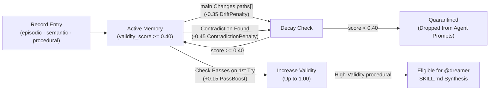
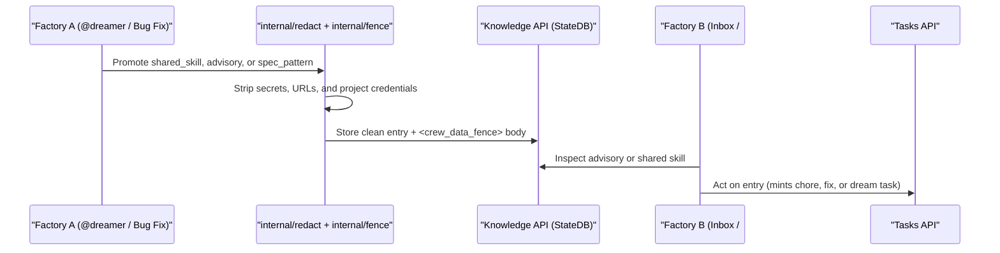

# Memory, Dreamstore, and Knowledge API

Crew separates per-project operational memory from cross-factory shared wisdom so projects never leak secrets or code across sandboxes (`Rule 1`, `Rule 14`). Project-scoped **Dreamstore** scores typed memories continuously for validity, **Scoped Dreaming** (`@dreamer`) distills verified recipes into harness edits behind your approval, and the **Knowledge API** scrubs and fences reusable skills, advisories, and spec patterns across all factories.

## Project-Scoped `Dreamstore` (`9.10`, `R215`)

Unlike static append-only note files, **Dreamstore** (`internal/memory/dreamstore.go`) organizes project memory into three cognitive kinds anchored to code paths and verified commit hashes. Continuous validity scoring (`0.00` to `1.00`) automatically promotes reliable recipes and quarantines stale hints.

- **Three cognitive tiers (`DreamKinds`):** `episodic` (timestamped run experiences and `@researcher` diagnoses), `semantic` (declarative architecture invariants anchored to `paths[]`), and `procedural` (step-by-step recipes eligible for skill distillation).
- **Automatic drift and quarantine:** When a merge to `main` modifies files matching an entry's `paths[]`, Crew applies `DriftPenalty` (`0.35`). Passing runs add `PassBoost` (`0.15`), contradictions subtract `ContradictionPenalty` (`0.45`), and any entry below `QuarantineThreshold` (`0.40`) drops out of future agent prompts automatically.

## Scoped Dreaming (`@dreamer`, `10.8`, `R216`)

`@dreamer` consolidates recent Trajectory Store records and high-validity `Dreamstore` entries during idle intervals without touching pipeline code, model selection rules, or security boundaries (`internal/dreamer/dreamer.go`). Every dreaming pass runs on Gemini (`Rule 15`) under a tracked `dream` task in **Tasks API**.

- **Three strictly confined outputs (`dreamer.Kinds`):**
  1. `context_micro_adjustment`: Small, evidence-backed edits to `AGENTS.md`, `WORKFLOW.md`, or `.agents/rules/*.md`.
  2. `skill_synthesis`: New `.agents/skills/<name>/SKILL.md` skills synthesized from recurring `procedural` memories.
  3. `vendored_download`: SHA-pinned external skills staged with source URL, commit hash, and licence.
- **Vetting and approval gates (`ErrOutOfScope`, `ErrBlocked`):** Every proposal passes path-scope validation and static AST security vetting (`internal/skills/vet.go`), then waits in **Inbox** until you approve before writing `main` or syncing warm microVMs.

## Cross-Project `Knowledge API`, Evals, and Global `improver`

Crew enables learning across projects on the same machine while preserving strict sandbox and credential isolation (`internal/knowledge/knowledge.go`, `internal/improve/`).

- **Secret-scrubbed cross-factory sharing (`9.11`, `R218`):** `Knowledge API` aggregates `shared_skill`, `advisory`, and `spec_pattern` records after `ScrubAndFence` strips credentials, URL userinfo, and secret shapes (`internal/redact`) and wraps content inside `<crew_data_fence>` (`Rule 14`). Acting on an entry in another project mints a tracked **Tasks API** ticket rather than mutating `main`.
- **Held-out Evals (`9.6`):** Completed tasks and fixed bugs seed held-out eval cases whose test files stay hidden from the builder and run inside an offline check sandbox (`13.9`) to guard overrides and baseline changes.
- **Crew-level `improver` (`10.4`–`10.5`):** Collects anonymous per-project signals (`first_request_pass_rate`, `check_rounds`, `rework`), proposes generic patches to `baseline/` (checked against project leakage), validates them across every project's eval suite, measures the next 20 tasks, and rolls back automatically on regression.

Reference: Dreamstore constants, Knowledge API kinds, and Crew metrics

| Component | Symbol / Constant | Value / Rule |
| :--- | :--- | :--- |
| Quarantine floor | `memory.QuarantineThreshold` | `0.40` (entries below this score leave active prompt injection) |
| Commit-drift decay | `memory.DriftPenalty` | `-0.35` when `main` modifies linked `paths[]` |
| Pass confirmation boost | `memory.PassBoost` | `+0.15` when a run applying the entry passes checks |
| Contradiction penalty | `memory.ContradictionPenalty` | `-0.45` on conflicting check or outcome evidence |
| Dreamer allowed paths | `dreamer.ValidateScope` | `AGENTS.md`, `WORKFLOW.md`, `.agents/rules/*.md`, `.agents/skills/<name>/SKILL.md` |
| Knowledge artifact kinds | `knowledge.Kinds` | `shared_skill`, `advisory`, `spec_pattern` |
| Eval guard window | `improvements.measure_after_tasks` | `20` finished tickets on the new version before automatic rollback check |

## Next steps

Follow how synthesized skills pass static AST vetting and how `Dreamstore` surfaces inside the control plane.

- See how synthesized skills are vetted and synced into warm microVMs in [07. Skills Registry and Harness](07-skills-registry-and-harness.md).
- Inspect `Dreamstore`, `Evals`, `Bugs`, `Feedback`, and `Decisions` tabs in [08. Visual Control Plane and 40 Themes](08-visual-control-plane-and-themes.md).
