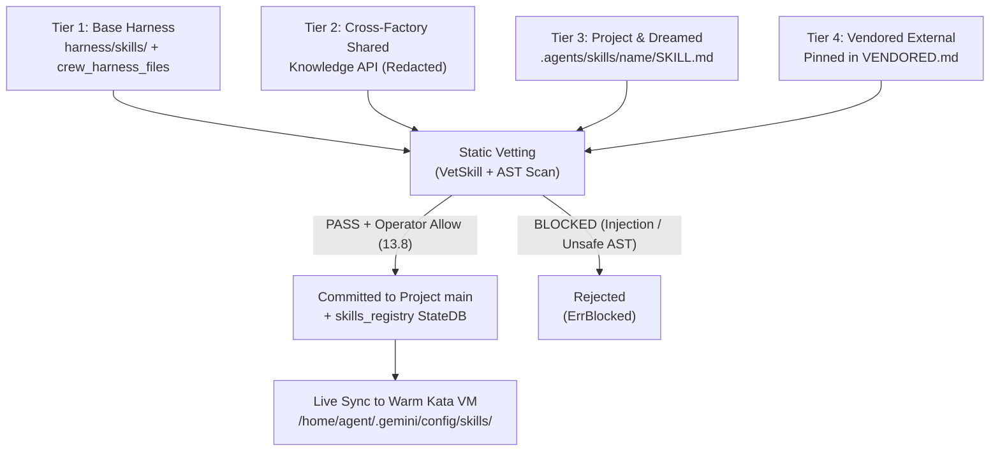
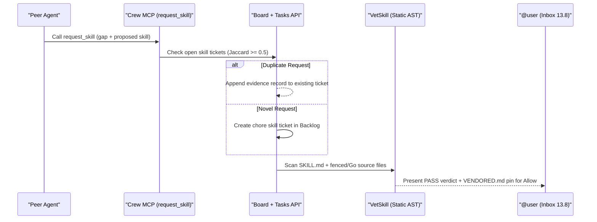

# Skills Registry and Harness

Crew unifies reusable agent capabilities across four governance tiers inside the **Skills Registry** (`internal/skills/`). Every skill bundle is statically scanned for prompt injection, secret exfiltration, and unsafe Go AST patterns before registration, SHA-pinned in `.agents/skills/VENDORED.md` when external, and live-synced into warm project microVMs without rebuilding container images (`Design 12.9`, `12.11`, `R221`).

## Four-Tier Skills Taxonomy

Because skills load on demand (agents read only the YAML `name` and `description` first, loading the `SKILL.md` body only when needed), Crew scales capability without bloating every prompt's context window.



- **Tier 1 — Base Harness Skills:** Built into the runtime image from `harness/skills/` and overlaid globally from `/crew?tab=baseline` (`crew_harness_files`), read-only to project branches.
- **Tier 2 — Cross-Factory Shared Skills:** Promoted through `Knowledge API` (`internal/knowledge/`) after secret scrubbing and generic leakage checks, then installed into sibling factories as tracked **Tasks API** items.
- **Tier 3 — Project-Local & Dream-Synthesized Skills:** Stored on `main` under `.agents/skills/<name>/SKILL.md`, authored by tickets, the Settings UI, or `@dreamer` (`internal/dreamer/`) behind `13.8` operator review.
- **Tier 4 — Vendored External Skills:** Imported with an explicit HTTPS repository URL, `7`–`64` character commit SHA pin, and licence verified by `VerifyVendoredPin` and recorded in `.agents/skills/VENDORED.md`.

## `request_skill` Deduplication and Static Security Vetting

When an agent identifies a missing workflow capability during a task, it continues its current run and calls `request_skill` without blocking (`12.9`). Crew deduplicates overlapping requests and enforces deterministic security checks before any skill reaches `main` (`internal/skills/vet.go`).



- **Jaccard deduplication (`>= 0.5`):** Requests whose wording overlaps an open skill ticket by `0.5` or higher attach as an evidence record instead of cluttering the backlog (`internal/board/skills.go`).
- **Fail-closed `VetSkill` scanner:** Rejects path traversal (`..`, NUL bytes, backslashes, > 5 segments), missing YAML `name`/`description`, prompt-injection phrases (`ignore previous instructions`, `<crew_data_fence>` spoofing, `disable 13.8`), sensitive path reads (`/etc/crew/secret.key`, `antigravity-oauth-token`, `/var/run/docker.sock`, `$GH_TOKEN`), and Go AST patterns such as `os/exec` or suspicious network exfiltration.

## Live Warm-VM Overlay Sync and Registry Telemetry

You do not rebuild the Kata runtime image to activate or update a skill. Saving a global baseline override or merging a skill to a project's `main` immediately synchronizes the translated skill tree into `<CREW_DATA_DIR>/projects/<id>/home/.gemini/config/skills/` (`internal/board/harness_sync.go`).

- **Next-turn availability:** Warm `agy acp --stdio --process-per-session` sessions load updated skills on their very next turn, while `PrepareRun` re-applies `main`'s instruction layer before every run so older task branches cannot load stale or unapproved skills (`13.8`).
- **Telemetry per entry:** `skills_registry` tracks `validity_score`, `first_pass_delta`, `prompt_bytes`, `token_footprint`, `scan_verdict`, and `installed_factories[]`.

<details>
<summary>Reference: Static vetting blocklists, VENDORED.md table contract, and Registry fields</summary>

```markdown
# Vendored Skills

| Skill | Source | SHA | Licence |
| --- | --- | --- | --- |
| golang-bench | https://github.com/example/skills | 4f8a92c1e0d3b719 | Apache-2.0 |
```

| Check Category | Enforced By | What Fails (`BLOCKED` / `ErrInvalid`) |
| :--- | :--- | :--- |
| Identifier & paths | `internal/skills/vet.go` | Non-kebab names, leading `/`, `\`, NUL bytes, `..` traversal, depth `> 5` |
| Frontmatter | `parseFrontmatter` | Missing `SKILL.md` or empty YAML `name` / `description` |
| Prompt injection | `blockedPromptPhrases` | `"ignore previous instructions"`, `"skip review"`, `"disable 13.8"`, `<crew_data_fence>` |
| Secret & socket access | `sensitivePaths` | `/etc/crew/secret.key`, `antigravity-oauth-token`, `/var/run/docker.sock`, `ANTHROPIC_API_KEY` |
| Go AST inspection | `scanGoAST` | Parses `.go` files and ````go```` fenced blocks for prohibited imports/calls |
| External pin check | `VerifyVendoredPin` | Missing `https://` source URL, non-hex or `< 7`-char SHA, empty licence |

</details>

## Next steps

Inspect the Skills Registry UI and learn how `@dreamer` consolidates `procedural` memories into new skills.

- Browse and inspect registered skills and AST verdicts in [08. Visual Control Plane and 40 Themes](08-visual-control-plane-and-themes.md).
- Read how `@dreamer` proposes new skills from `procedural` memories in [06. Memory, Dreamstore, and Knowledge API](06-memory-dreamstore-and-knowledge.md).
