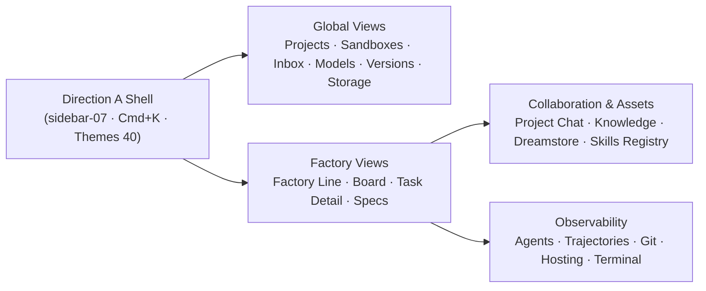
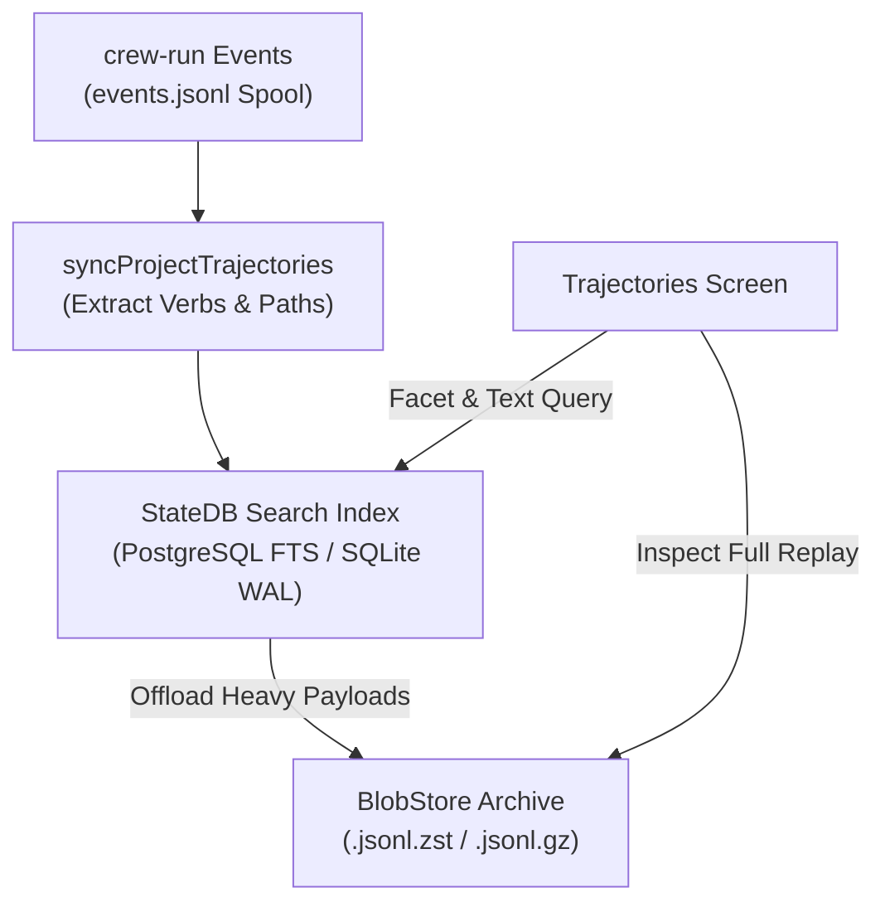

# Visual Control Plane and 40 Themes

Crew embeds a containerized React + TanStack Router + Tailwind CSS control plane (`Direction A`, `sidebar-07` inset collapsible navigation) directly inside `crew-server` (`web/src/`). It surfaces real-time peer agent streams across ten per-project operational views, indexes full trajectories with `BlobStore` replay, adapts cleanly down to `390px` mobile screens, and ships **40 runtime-switchable themes** (`Design 8.7`, `20.1`–`20.4`).

## Control Plane Shell and Ten Factory Views

The **Direction A** layout (`DECISION.md`) keeps multi-project status, `⌘K` command palette (`Jump to…`), active slot counts, running sandboxes, and **Inbox** alerts visible in a 52px header while organizing each open project around ten core operational surfaces.

- **Live Factory Line (`p.$project.factory.tsx`):** Streams SSE stage updates across `Specs -> Backlog -> Build -> Review -> Checks -> Done`, showing active `FactoryTask` units, `@researcher` briefs, peer ACP sessions, and trajectory series.
- **Keyboard-first Kanban & Task Detail:** Navigate **Board** cards with `j` / `k`, press `Enter` to open **Task Detail** (`All`, `Spec & Checks`, `Live Run & Diff`, `Prompt`, `Reviews & History`), or press `y` to toggle the raw `.crew/tickets/<KEY>.md` YAML modal.
- **Inline text actions (`20.2`):** Highlighting any diff, log, or trajectory line pops up **Comment** (to quote into chat with provenance), while highlighting your own draft text offers **Improve text** and **Review text**.
- **Mobile & CSP hygiene:** A `390px` slide-over drawer handles phone screens using `VisualViewport` keyboard adaptation (`touch-action: pan-y pinch-zoom`), with zero inline `style=` attributes (`CSP`) and strict zero-budget/currency copy (`nodollars`).

## Trajectory Store Search and `BlobStore` Replay

Every run event streams into **Trajectory Store** (`internal/httpapi/m25_trajectories.go`), supporting instant full-text and facet search (`trajectories_fts` + SQLite WAL fallback) across roles, models, tool verbs, touched paths, and outcomes (`live`, `pass`, `research`, `max_tries`, `error`).

- **Transparent archive offload:** Heavy raw event streams offload to compressed `.jsonl.zst` (or `.jsonl.gz`) objects in `BlobStore` (`POST /api/projects/{p}/trajectories/{run}/offload`) while keeping fast full-text metadata searchable in `StateDB`.

## 40 Runtime-Switchable Themes (`Themes (40)`)

Click **Themes (40)** in the top bar (or press `d` outside text inputs to flip dark/light mode) to preview palettes in the **Swatch Gallery** (`web/src/components/theme-gallery.tsx`). Selections apply immediately via CSS variables (`web/src/styles/themes-40.css`, default `catppuccin` dark) and persist per operator in `StateDB` (`operator_prefs`) and `localStorage`.

Reference: All 10 factory views, keyboard shortcuts, and all 40 shipping themes

### Keyboard Shortcuts

| Shortcut | Screen | Action |
| :--- | :--- | :--- |
| `Cmd+K` / `Ctrl+K` | Global | Open Command Palette across projects, tickets, sandboxes, and screens |
| `d` | Global | Toggle dark / light mode |
| `j` / `k` | Board | Select next / previous ticket card |
| `Enter` | Board | Open selected ticket detail view |
| `y` | Board | Toggle `.crew/tickets/<KEY>.md` YAML modal for selected card |
| `Escape` | Global / Board | Close Command Palette, Theme Gallery, mobile drawer, or YAML modal |

### All 40 Themes (`web/src/lib/themes.ts`)

- **11 Product & AI-Native:** `linear`, `claude`, `vercel`, `warp`, `supabase`, `vesper`, `flexoki`, `oxocarbon`, `poimandres`, `night-owl`, `synthwave`
- **9 Official `shadcn/ui` Presets:** `default`, `shadcn-zinc-blue`, `shadcn-stone-amber`, `shadcn-zinc-violet`, `shadcn-olive-emerald`, `shadcn-mauve-rose`, `shadcn-mist-cyan`, `shadcn-taupe-orange`, `shadcn-zinc-teal`
- **20 Dotfile & Editor Classics:** `catppuccin` (default), `catppuccin-macchiato`, `catppuccin-frappe`, `tokyo-night`, `tokyo-night-storm`, `tokyo-night-moon`, `dracula`, `one-dark`, `github`, `gruvbox`, `nord`, `rose-pine`, `rose-pine-moon`, `kanagawa`, `kanagawa-dragon`, `solarized`, `everforest`, `ayu`, `ayu-mirage`, `monokai`

## Next steps

Explore how UI preferences and trajectory blobs persist on disk and how fresh sign-in prompts protect sensitive routes.

- Learn how `operator_prefs` and offloaded `.jsonl.zst` archives persist in [09. Split Storage and Git Store](09-split-storage-and-git-store.md).
- Read how `FRESH_SIGN_IN` dialogs guard sensitive actions in [10. Self-Update, Hosting, and Operations](10-self-update-hosting-and-operations.md).
