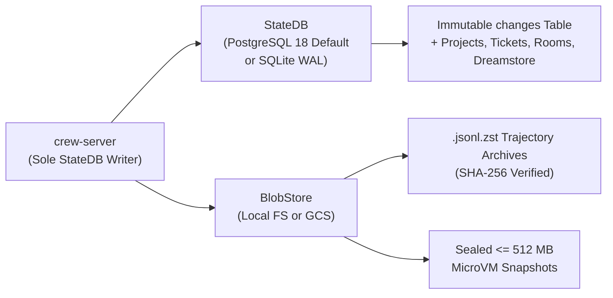
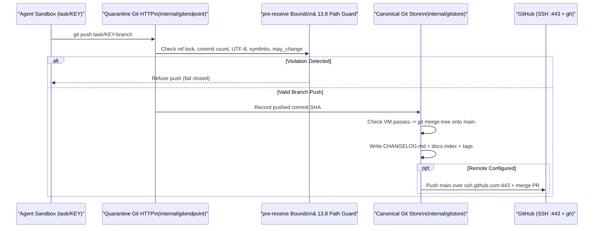

# Split Storage and Git Store

Crew divides persistence cleanly between hot relational metadata (`StateDB`), immutable binary archives (`BlobStore`), and a dual-repository Git engine where sandboxes push only to isolated task branches (`Quarantine`) while `crew-server` acts as the sole writer of `main` (`Canonical`). Every logical state change and git commit is recorded atomically with zero database triggers (`Design 5.1`, `6.1`–`6.8`, `R220`).

## Split Storage (`StateDB` + `BlobStore`)

Separating structured transactional state from large immutable blobs keeps database backups small and prevents heavy trajectory logs or VM snapshots from bloating relational tables (`internal/db/`, `internal/blobstore/`).

- **`StateDB` (`PostgreSQL 18` or `SQLite` WAL):** `crew-db` (`postgres:18.6-trixie`) runs on the internal `crew-net` bridge with `0001`–`0094` migrations as the multi-factory default. An embedded `SQLite` WAL store (`internal/db/sqlite/sqlite.go`) supports lightweight single-binary persistence for `operator_prefs`, trajectories, and blob manifests, switchable from **Runtimes & Storage** (`/storage`).
- **Immutable `BlobStore` (`internal/blobstore/`):** Implements `Put`, `Get`, `Stat`, `List`, `Delete`, and `Health` over **Local FS** (`fs.go`) or **GCS** (`gcs.go`), compressing trajectory logs with `zstd` (falling back transparently to `gzip`) and rejecting path escapes via `CleanKey`.
- **Append-only audit trail (`6.4`):** Every state transition writes an immutable row to `changes` (timestamp, actor, target, before/after JSON) in the exact same transaction as the state mutation.

## Dual-Repository Git Architecture and Security Bounds

No sandbox can touch a canonical repository or push `main` (`Rule 4`, `13.8`). Crew enforces strict separation between untrusted sandbox pushes and canonical `main` commits (`internal/gitendpoint/`, `internal/gitstore/`).

- **Quarantine pre-receive enforcement (`prereceive.go`):** Refuses pushes targeting another ticket's ref, branch deletions, non-commit tags, commits exceeding `CREW_NEW_COMMITS` or `CREW_COMMIT_BYTES`, non-UTF-8 commit messages, oversized trees (`CREW_TREE_PATHS`, `CREW_TREE_BYTES`, `CREW_PATH_BYTES`), symlinks pointing across protected trees, and paths outside `analysis.may_change`.
- **Canonical `main` & Documentation Indexing (`internal/board/docs.go`):** On merge, `crew-server` writes `CHANGELOG.md` and `docs/decisions/NNNN-*.md` directly into the checked candidate commit, indexes markdown files under `README.md` and `docs/`, and flags pages whose `covers:` frontmatter matches changed code without updating the doc (`outdated_since`).
- **GitHub sync & project portability:** Outbound SSH traffic connects via `ssh.github.com:443` against pinned host keys (`6.6`), while `crew-ctl project export` and `import` transfer board state, settings, and git history between Crew instances (`6.2`).

Reference: Data residency and retention matrix across StateDB, BlobStore, and Git

| Artifact | Primary Store | Retention Policy | Notes |
| :--- | :--- | :--- | :--- |
| Code, docs (`README.md`, `docs/`), skills, specs | Canonical Git (`main`) | Repository lifetime | Indexed into `doc_pages` on every `main` move |
| Projects, tickets, subtasks, records, `changes` | `StateDB` | Permanent (until project delete) | Transactional; `changes` rows never edited |
| `Dreamstore`, `Knowledge API`, `Skills Registry` | `StateDB` | Permanent | Secret-scrubbed across projects (`internal/redact`) |
| Compressed trajectories & VM snapshots | `BlobStore` (`Local FS` \| `GCS`) | Immutable (`512 MB` snapshot cap) | Trajectories never evicted to free disk (`Rule 10`) |
| Sealed CLI conversation files (`cli_files`) | `StateDB` (AES-sealed) | `7` days after run (`30` days chat) | Stripped of `STEP_TYPE_ERROR` on resume |
| Terminal & MCP token logs | `StateDB` (sealed) | `180` days (`16 MB` attachment cap) | Records Edit Mode terminal I/O |
| Credentials & hosted app secrets | `StateDB` (AES-sealed) | Until replaced | Encrypted with host-only `/etc/crew/secret.key` |
| Daily backups & event archives | Host `/var/lib/crew/backups/` | `14` daily files + permanent monthly events | Restored via `sudo crew-ctl restore FILE` |

## Next steps

Learn how backups, disk guards, and release gates protect persisted state and inspect storage metrics in the control plane.

- Review how backups, self-healing disk guards, and updates protect storage in [10. Self-Update, Hosting, and Operations](10-self-update-hosting-and-operations.md).
- Inspect `Runtimes & Storage` and `Trajectories` in [08. Visual Control Plane and 40 Themes](08-visual-control-plane-and-themes.md).
