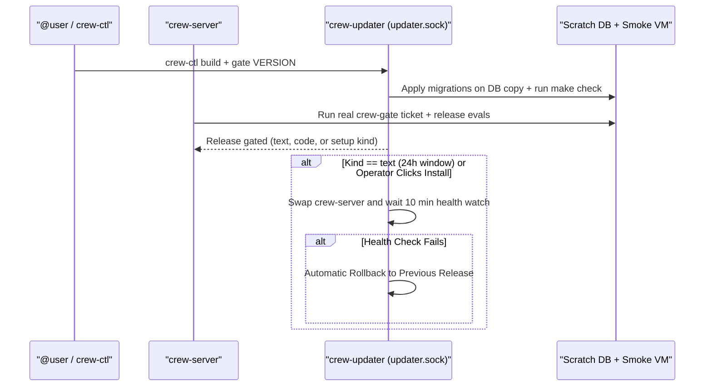
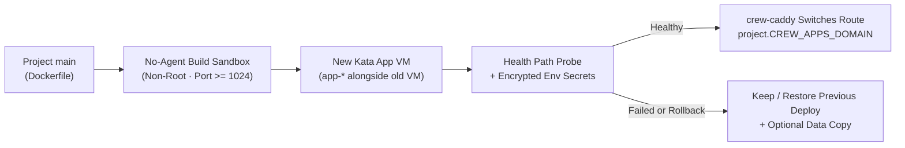

# Self-Update, Hosting, and Operations

Crew builds, verifies, gates, and atomically upgrades its own containers (`Crew builds Crew`, `Design 16.2`), hosts your project applications inside dedicated Kata microVMs (`Section 19`), protects sensitive settings behind `15`-minute fresh sign-ins (`20.3`), and heals itself automatically across disk pressure, microVM boot failures, and OS security updates (`Section 21`).

## Self-Update Gate, Atomic Swap, and Rollback (`crew-updater`)

No release touches your running `crew-server` until it passes static checks, scratch-database migration verification, a live smoke microVM, a real ticket on `crew-gate`, and release evals (`internal/updater/`, `internal/release/`).

- **Three release kinds (`internal/release/kind.go`):** Only `text` releases (`baseline/` markdown prompts and skills) auto-install 24 hours after passing the gate unless held; `code` releases (or any file in `release.Protected`) always wait for your **Install** click behind a fresh sign-in; `setup` releases prompt for `sudo deploy/crew-ctl install --upgrade-runtime` first (`Rule 12`).
- **Second-machine portability:** Export a compact release card (`release.json`, `deploy.tar.gz`, `notes.md`) from your build machine and install or pull verified image digests onto other servers with zero git checkout (`crew-ctl release card` / `release pull`).

## Hosting Project Applications (`<project>.<CREW_APPS_DOMAIN>`)

Any project with a `Dockerfile` on `main` can deploy onto the same host directly from its **Hosting** screen (`internal/hosting/`).

- **Sandboxed execution:** Hosted app containers must run as non-root on `hosting.port >= 1024`, with outbound internet enabled by default (`hosting.internet: true`) and an optional offline `apo-*` bridge mode (`hosting.internet: false`).
- **Encrypted secrets & rollback:** Environment variables are encrypted in one vault entry behind a fresh sign-in (only variable names return to the browser). Rolling back restores the prior image and optionally restores `hosting.data_copies`.

## Auth, Notifications, Backups, and Self-Healing

Crew continuously monitors host health, disk headroom, database writability, and TLS certificates so unattended factory runs recover safely without corrupting state.

- **Device sessions & `FRESH_SIGN_IN` (`20.3`):** Google OAuth2 via `crew-caddy` grants `30`-day device sessions (revocable per device in **Settings**). Sensitive routes—opening terminals or edit mode, secrets, personal tokens, releases, LAN network modes, public hosting, and agreeing to `13.8` file edits—require a `15`-minute fresh sign-in (`prompt=select_account`).
- **Notifications (`Section 18`):** **Inbox** lists active escalations computed live from system state; optional SMTP alerts (`notifications.mail_to`) send **Needs you** notifications immediately and bundle non-urgent updates into a daily **News** digest.
- **Self-healing holds (`Section 21`):** Daily backups write `.tar.gz` archives to `/var/lib/crew/backups/` (keeping 14 days + monthly event archives); `diskguard` cleans old artifacts at `clean_at` and pauses new work at `stop_at`; two consecutive microVM boot failures pause runs and launch a 5-minute probe that auto-resumes when KVM recovers; `crew-restart.timer` applies quiet-hour OS security reboots (`02:00`–`05:00`) only when zero sandboxes or terminals are active.

Reference: Fresh sign-in gated actions and Section 21 self-healing holds

### Fresh Sign-In Gated Actions (`<= 15 minutes`)

- **Terminals & Setup:** Opening Project Terminal (or switching to Edit mode), Run Terminal, or Setup terminal; managing GitHub App key or SMTP mail credentials.
- **Releases & Holds:** Clicking **Install**, **Install now**, **Rollback**, lifting `Pause all` / `Stop all` / boot holds, accepting a held `main` push (`13.8`), or approving an agent-created ticket touching protected paths.
- **Security & Network Settings:** Changing `updates.auto_install`, `network.mode`, `sandbox.sources`, `sessions.days`, `sessions.fresh_minutes`, `agents.checks_use_another_family`, widening hosted app access, enabling `hosting.internet`, editing hosted app secrets, or revoking signed-in devices.

### Self-Healing Holds and Probes

| Condition | Trigger | Automatic Recovery |
| :--- | :--- | :--- |
| MicroVM boot failure | `2` consecutive boot failures | Pauses new starts; runs 5-minute probe and auto-resumes on first healthy boot |
| Database unreachable | 30-second write probe fails | Holds work and posts recovery notice in **Inbox** once writable |
| Disk pressure | Crosses `clean_at` / `stop_at` | Evicts expired artifacts first; pauses new runs at `stop_at` until space frees |
| Host security reboot | `crew-restart.timer` (15m) | Waits for `machine_care.restart_hours` (`02:00–05:00`) with zero active runs/terminals |
| TLS certificate expiry | Daily cert check | Sends **News** alert when `<= 14` days remain on ingress cert |

## Next steps

Use the operational CLI commands and package map below for day-to-day administration, installation, and troubleshooting.

- Follow end-to-end bootstrap, second-machine rollouts, and Level 1-3 uninstall steps in [Install, Update, and Uninstall Guide](../install-and-uninstall.md).
- Run host diagnostics and backup commands listed in [README.md](../../README.md#day-2-operations-crew-ctl).
- Review every package boundary in [Architecture](../architecture.md).
