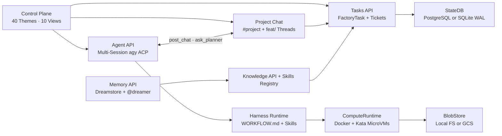
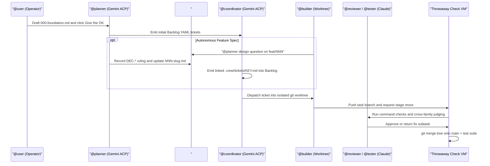

# Features Overview

Crew `2.0` organizes autonomous software delivery around seven backend modules, hardware-isolated Kata Containers microVMs, and ten interactive control-plane surfaces. Each feature guide below explains how a subsystem works end to end, what safety boundaries constrain it, and where its implementation lives in the repository.

## End-to-End Delivery Lifecycle

Every feature in Crew follows one governed path from design intent to verified production code on `main`. You approve Tier 1 foundation scope once; after that, peer agents collaborate inside isolated sessions and check sandboxes to move work to `Done`.

## Feature Guides

Explore each feature guide below for architecture diagrams, safety invariants, schema references, and package pointers.

| Guide | What It Covers | Design Refs | Primary Packages |
| :--- | :--- | :--- | :--- |
| [Workflow, Goal & DoD (WORKFLOW.md)](../../WORKFLOW.md) | End-to-end **Plan to Finish** & **Feature to Finish** flow, 4-part **Goal** contract, Goal Loop, and 4-tier **Definition of Done** | `6.8`, `7.1`–`7.14`, `11.3`, `16.2` | `internal/board/`, `internal/pipeline/`, `internal/runs/` |
| [01. Two-Tier Planning & Specs](01-two-tier-planning-and-specs.md) | Tier 1 foundation plans, `WORKFLOW.md`, autonomous `@agent` to `@planner` feature specs, `DEC-*` rulings, and `13.8` escalations | `6.8`, `7.2`, `7.14` | `internal/planning/`, `internal/rewrite/`, `internal/board/` |
| [02. Tasks API & Stage Pipeline](02-tasks-api-and-stage-pipeline.md) | Mandatory `FactoryTask` pre-compute boundary, Kanban stages, parallel subtasks, `max_tries` to `@researcher`, and `git merge-tree` merges | `6.8`, `7.4`–`7.14`, `R217` | `internal/board/`, `internal/pipeline/` |
| [03. Agent API & Peer Specialists](03-agent-api-and-peer-specialists.md) | Multi-session `agy acp` peer control plane, custom `WORKFLOW.md` specialists, `Rule 15` model routing, `lead_waits` queue, and continuation | `7.9`, `11.10`, `12.2`–`12.10` | `internal/runs/`, `internal/cli/`, `internal/models/`, `cmd/crew-run/` |
| [04. Project Chat & Choice Prompts](04-project-chat-and-choice-prompts.md) | Unified `#<project>` room and `feat/<NNN>-<slug>` threads, CommonMark `@mentions`, `steer`, `<crew_data_fence>`, and keyed `ChoicePrompt` cards | `11.10`, `R214` | `internal/rooms/`, `internal/fence/`, `internal/httpapi/rooms.go` |
| [05. Sandboxes & ComputeRuntime](05-sandboxes-and-compute-runtime.md) | Kata Containers microVMs, `ComputeRuntime` warm pause/resume/snapshots, `/29` firewall bridges, TLS egress proxy, and credential custody | `12.6`, `13.1`–`13.12`, `R219` | `internal/sandboxes/`, `internal/orchestrator/`, `internal/credbroker/`, `deploy/firewall/` |
| [06. Memory, Dreamstore & Knowledge API](06-memory-dreamstore-and-knowledge.md) | `Dreamstore` validity scoring (`0.00`–`1.00`), `@dreamer` scoped dreaming, cross-factory `Knowledge API`, held-out Evals, and `improver` | `9.6`–`9.11`, `10.1`–`10.8`, `R215`–`R218` | `internal/memory/`, `internal/dreamer/`, `internal/knowledge/`, `internal/improve/` |
| [07. Skills Registry & Harness](07-skills-registry-and-harness.md) | Four-tier skill catalog, `request_skill` Jaccard deduplication, static AST vetting, `VENDORED.md` pins, and warm-VM overlay sync | `12.9`, `12.11`, `R221` | `internal/skills/`, `internal/harnessbuild/`, `harness/`, `baseline/` |
| [08. Visual Control Plane & 40 Themes](08-visual-control-plane-and-themes.md) | `Direction A` React shell, 10 factory views, `trajectories_fts` replay, inline comment tools, `⌘K` palette, and 40 themes | `8.7`, `20.1`–`20.4` | `web/src/`, `internal/httpapi/m25_factory.go`, `internal/httpapi/m25_trajectories.go` |
| [09. Split Storage & Git Store](09-split-storage-and-git-store.md) | `StateDB` (`PostgreSQL` or `SQLite` WAL), `BlobStore` (`Local FS` or `GCS`), audit `changes`, Quarantine vs Canonical Git, and GitHub sync | `5.1`, `6.1`–`6.7`, `R220` | `internal/db/`, `internal/blobstore/`, `internal/gitstore/`, `internal/gitendpoint/` |
| [10. Self-Update, Hosting & Operations](10-self-update-hosting-and-operations.md) | `crew-updater` side-by-side gate and 10-minute rollback, project app hosting, `FRESH_SIGN_IN` auth, SMTP alerts, backups, and self-healing | `16`, `18`, `19`, `20.3`, `21` | `cmd/crew-updater/`, `internal/updater/`, `internal/hosting/`, `internal/machinecare/` |

## Next steps

Use the links below to explore host setup, package boundaries, and the complete technical design specification.

- Return to the root overview in [README.md](../../README.md) for host prerequisites and quick-start installation commands.
- Read the complete workflow, **Goal**, and **Definition of Done** specification in [WORKFLOW.md](../../WORKFLOW.md).
- Browse the Go package inventory in [Architecture](../architecture.md) and developer test commands in [Setup](../setup.md).
- Read the complete 28-section source specification starting at [docs/plan/agent-kanban-tdd.md](../plan/agent-kanban-tdd.md).
