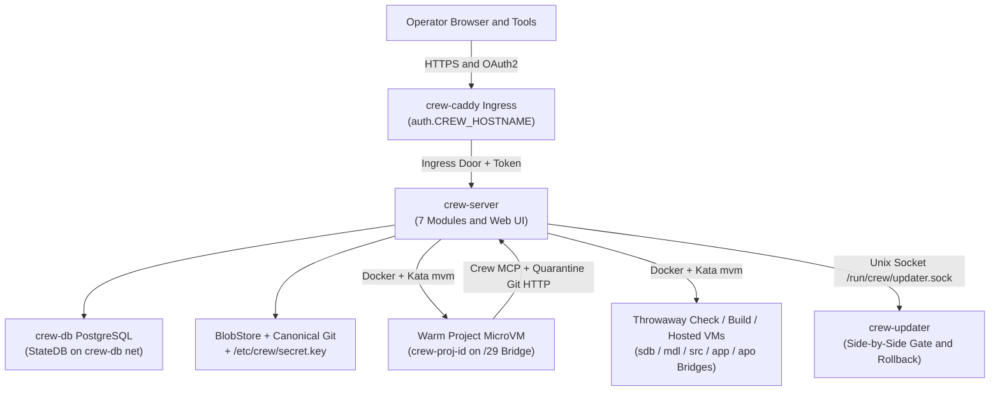
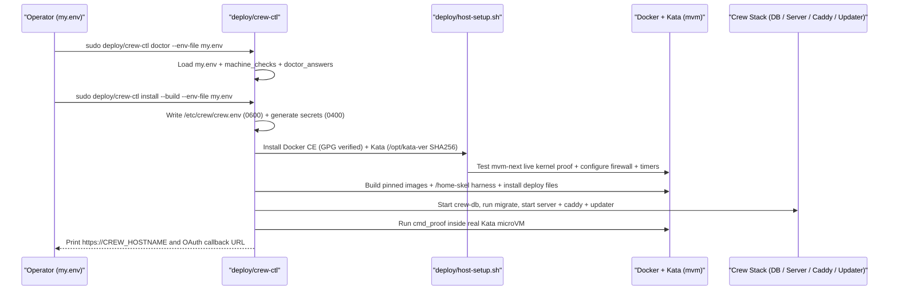
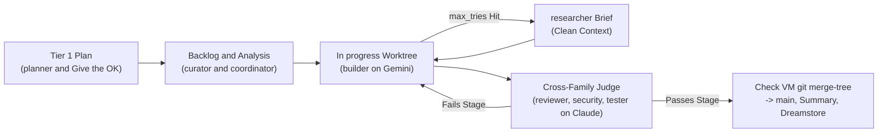
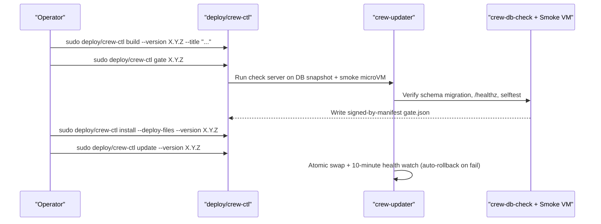
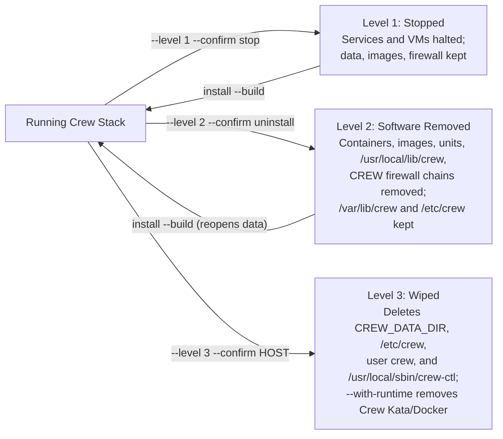

# Install, Update, and Uninstall Guide

Crew installs as a self-contained Docker Compose stack paired with Kata Containers microVMs (`Cloud Hypervisor`) managed end-to-end by [`deploy/crew-ctl`](../deploy/crew-ctl). You do not need Go, Node.js, or Kata pre-installed on the host: `install` verifies hardware and configuration first (`doctor`), bootstraps Docker CE and static Kata assets from [`versions.lock`](../versions.lock), builds or pulls pinned images, brings up `crew-db`, `crew-server`, `crew-caddy`, and `crew-updater`, and proves microVM kernel isolation before exposing the web UI.

> [!NOTE]
> Crew's source repository is licensed under **Apache-2.0** ([`LICENSE`](../LICENSE); see [`THIRD_PARTY.md`](../THIRD_PARTY.md) for third-party notices and adapted provenance). Compiled `crew-runtime` images contain third-party vendor CLIs (`agy`) and must stay local to your host or in your own private container registry.

## Architecture and Isolation Boundaries

Everything stateful lives inside `crew-db` (PostgreSQL) and host volumes owned by system user `crew`, while untrusted agent execution and project builds run inside hardware-isolated Kata microVMs that never see host secrets or Docker's socket.



## Prerequisites and Hardware Sizing

`deploy/crew-ctl doctor` enforces machine and network readiness before modifying any file under `/etc/crew/`, Docker, or `iptables`.

<details>
<summary>Supported OS platforms, hardware thresholds, network endpoints, and account guidance</summary>

| Requirement | Minimum (`doctor` fail below) | Recommended (`doctor` warn below) | Notes |
| :--- | :--- | :--- | :--- |
| Architecture | `x86_64` (`AMD64`) | `x86_64` (`AMD64`) | ARM hosts are refused by `host-setup.sh` |
| Linux Distro | Debian 13 (`trixie`) or Ubuntu 24.04+ | Debian 13 or Ubuntu 24.04+ LTS | Checked via `/etc/os-release` |
| Virtualization | `/dev/kvm` present | Bare metal or nested-KVM VM | Required for Kata `mvm` runtime |
| CPU and RAM | `8` threads, `32 GB` RAM | `16` threads, `64 GB` RAM | Warm VM defaults: `6` vCPU, `8 GiB` RAM, `20 GiB` disk |
| Disk Free | `200 GB` on `CREW_DATA_DIR` | `500+ GB` NVMe/SSD | Holds DB, git stores, snapshots, images, backups |
| Ports & Clock | TCP `80`/`443` free; clock skew `<= 30s` | NTP active | Ports may only be held by `crew-caddy` on upgrades |
| Reachability | `github.com`, `download.docker.com`, `accounts.google.com`, `registry-1.docker.io` | Direct outbound HTTPS | Checked during `doctor` |

- **Ubuntu test prerequisite:** Running the unprivileged firewall namespace test suite inside `make check` on Ubuntu hosts with AppArmor userns restriction requires `sudo sysctl -w kernel.apparmor_restrict_unprivileged_userns=0`.
- **Recommended `agy` account hygiene (`Design 12.6`):** The `agy` CLI token carries the `https://www.googleapis.com/auth/cloud-platform` OAuth scope. Use a **dedicated Google account** for `agy` that has no access to sensitive Google Cloud projects, keeping production cloud access separated from agent sandboxes.

</details>

## Bootstrap Flow Overview

Installing from scratch executes in strict preflight-then-provision order so a failing prerequisite leaves your machine untouched.



## Configuration (`my.env` and `/etc/crew/crew.env`)

Start by copying [`.env.example`](../.env.example) to `my.env` in a gitignored location. Never pass secrets as flags on shell history where avoidable; `crew-ctl install` writes `/etc/crew/crew.env` (`0600`), generates internal keys (`db_postgres`, `db_crew`, `db_crew_migrate`, `db_crew_read`, `ingress_token`, and `/etc/crew/secret.key`) at `0400` owned by `crew:crew`, and leaves `GOOGLE_CLIENT_SECRET` / `CLOUDFLARE_API_TOKEN` in `/etc/crew/secrets/`.

<details>
<summary>All 11 install keys from .env.example (4 required, 7 optional)</summary>

| Variable | Required | Default | Purpose |
| :--- | :--- | :--- | :--- |
| `CREW_HOSTNAME` | **Yes** | `crew.example.com` | Primary UI/API hostname; OAuth login serves on `auth.<CREW_HOSTNAME>` |
| `CREW_ADMIN_EMAIL` | **Yes** | `you@example.com` | Single Google email authorized as operator and ACME contact |
| `GOOGLE_CLIENT_ID` | **Yes** | Empty | Google OAuth 2.0 Web Application Client ID |
| `GOOGLE_CLIENT_SECRET` | **Yes** | Empty | Google OAuth 2.0 Web Application Client Secret |
| `CREW_APPS_DOMAIN` | No | Empty | Hosted project domain (`<project>.<CREW_APPS_DOMAIN>`). Must not equal or overlap `CREW_HOSTNAME` |
| `CLOUDFLARE_API_TOKEN` | No | Empty | DNS-edit API token for automatic DNS records and wildcard ACME certs |
| `CREW_TLS` | No | `acme` | `acme` (Let's Encrypt), `staging` (LE staging), or `internal` (Caddy self-signed CA; skips DNS/OAuth online checks) |
| `CREW_DATA_DIR` | No | `/var/lib/crew` | Persistent root for `db/`, `repos/`, `canonical/`, `sandboxes/`, `hosted/`, `backups/`, `releases/` |
| `CREW_TIMEZONE` | No | Host TZ | IANA timezone for quiet-hour security reboots (`02:00-05:00`) and UI |
| `CREW_SOURCE_REPO` | No | Empty | Initial `owner/name` repo seed for self-building releases (e.g. `your-org/crew`) |
| `CREW_ALLOW_IP_FORWARD` | No | Empty | Leave empty; `1` overrides fail-closed netns bridge forwarding check (`doctor` warns while `1`) |

</details>

To change a value after installation, run `sudo crew-ctl edit KEY=VALUE` (or `sudo crew-ctl edit GOOGLE_CLIENT_SECRET` without `=VALUE` so the prompt reads secrets securely without shell history exposure).

## Track A: Local Evaluation or Test VM (`CREW_TLS=internal`)

Use Track A inside an isolated KVM virtual machine or lab host where you want a working Crew installation without public DNS or live Google OAuth verification during `doctor`:

1. Create `my.env` from `.env.example` with internal TLS mode:
   ```bash
   cp .env.example my.env
   cat > my.env <<'EOF'
   CREW_HOSTNAME=crew.local.example
   CREW_ADMIN_EMAIL=you@example.com
   GOOGLE_CLIENT_ID=local-dev-placeholder
   GOOGLE_CLIENT_SECRET=local-dev-placeholder
   CREW_TLS=internal
   CREW_DATA_DIR=/var/lib/crew
   CREW_SOURCE_REPO=your-org/crew
   EOF
   chmod 0600 my.env
   ```
2. Preview actions without modifying the machine, then run `doctor` and `install --build`:
   ```bash
   sudo deploy/crew-ctl install --build --env-file my.env --dry-run
   sudo deploy/crew-ctl doctor --env-file my.env
   sudo deploy/crew-ctl install --build --env-file my.env
   ```
   When `CREW_TLS=internal` is active, `doctor` logs `skip names CREW_TLS=internal: the names and the sign-in client are not checked`.
3. Verify the running stack and execute a full sandbox round-trip self-test:
   ```bash
   sudo crew-ctl status --json
   sudo crew-ctl selftest
   ```

## Track B: Production Host (`CREW_TLS=acme`) and Second-Machine Rollout

### Single Production Host

1. **Configure DNS & OAuth2:** Point `<CREW_HOSTNAME>` and `auth.<CREW_HOSTNAME>` (`A`/`AAAA`) at the host (plus `*.<CREW_APPS_DOMAIN>` and `auth.<CREW_APPS_DOMAIN>` if hosting apps, or provide `CLOUDFLARE_API_TOKEN`). In Google Cloud Console, create a **Web application** OAuth Client ID and register:
   - `https://auth.<CREW_HOSTNAME>/oauth2/google/authorization-code-callback`
   - `https://auth.<CREW_APPS_DOMAIN>/oauth2/google/authorization-code-callback` (when `CREW_APPS_DOMAIN` is set)
2. **Preflight and install:**
   ```bash
   cp .env.example my.env
   # Populate CREW_HOSTNAME, CREW_ADMIN_EMAIL, GOOGLE_CLIENT_ID, GOOGLE_CLIENT_SECRET (+ optional keys)
   chmod 0600 my.env
   sudo deploy/crew-ctl doctor --env-file my.env
   sudo deploy/crew-ctl install --build --env-file my.env
   ```
   When `--env-file` is omitted, `install` prompts interactively for each key before writing `/etc/crew/crew.env`.
3. **Complete `/setup` in the browser:** Open `https://<CREW_HOSTNAME>`, sign in as `CREW_ADMIN_EMAIL`, and configure:
   - **`agy` session** inside the isolated Setup microVM (ideally with a dedicated low-privilege Google account).
   - **Git identity, Ed25519 SSH key, and `gh auth login`** (stored encrypted in `crew-db`; write credentials stay exclusively on `crew-server`).
   - **Private Read-Only GitHub App** (1-hour `contents:read` installation tokens minted per sandbox) and optional **SMTP App Password** for `Needs you` / `News` emails.

### Installing or Updating a Second Machine (No Checkout Needed)

Secondary hosts do not clone source repositories, run the improver, or build `crew-runtime` images locally. Instead, they verify the release card (`release.json`, `gate.json`, `notes.md`, `deploy.tar.gz`) exported from your primary build machine and pull pinned image digests from your **private container registry** using a one-shot credential file read into tmpfs `/run/crew-login.XXXXXX`:

1. **On the primary build host:** Push your release images to your private registry, then export the compact release card:
   ```bash
   sudo deploy/crew-ctl release card 0.4.0 --out ~/cards
   ```
2. **Fresh second host first install (`install --from`):** Copy `0.4.0/` to the second machine, extract `deploy.tar.gz`, supply a temporary `USER:TOKEN` registry file (copied into a temporary `/run/crew-login.XXXXXX` Docker config directory that `install` removes on logout; delete your token file afterward), and run `install`:
   ```bash
   mkdir -p crew-deploy && tar -xzf 0.4.0/deploy.tar.gz -C crew-deploy
   install -m 0600 /dev/null /tmp/reg.token && printf 'USER:TOKEN\n' > /tmp/reg.token
   sudo crew-deploy/deploy/crew-ctl install --from ./0.4.0 \
     --registry ghcr.io/your-org \
     --registry-token-file /tmp/reg.token \
     --env-file my.env
   rm -f /tmp/reg.token
   ```
3. **Subsequent updates on the second host (`release pull` or offline `release import`):**
   ```bash
   # Pull verified linux/amd64 manifests + configs from your private registry:
   sudo crew-ctl release pull ./0.4.1 --registry ghcr.io/your-org --registry-token-file /tmp/reg.token
   # Or import an offline full release folder containing image tarballs:
   sudo crew-ctl release import /path/to/0.4.1
   # Then apply deploy-file changes if compose.yaml changed, and update:
   sudo crew-ctl install --deploy-files --version 0.4.1
   sudo crew-ctl update --version 0.4.1
   ```

## Reproducibility and `versions.lock` Apt Package Recovery

All 44 toolchain versions, base container digests, Kata hashes, and tool checksums are pinned in [`versions.lock`](../versions.lock) and enforced against `go.mod`, `ingress/go.mod`, `web/.node-version`, and the Dockerfiles by [`tools/check-versions.py`](../tools/check-versions.py).

Upstream apt repositories occasionally prune older point releases after an image build or security update (`DOCKER_VERSION` in `host-setup.sh`; `RUNTIME_DOCKER_CE_VERSION`, `RUNTIME_CONTAINERD_VERSION`, `RUNTIME_BUILDX_VERSION`, `RUNTIME_COMPOSE_VERSION`, `RUNTIME_GH_VERSION`, `RUNTIME_GCLOUD_VERSION`, and `RUNTIME_KUBECTL_VERSION` in [`image/Dockerfile`](../image/Dockerfile)). If an image build or `host-setup.sh` fails because a pinned apt version vanished upstream:

1. Query the exact currently available package versions inside a throwaway `debian:trixie` container:
   ```bash
   docker run --rm debian:trixie bash -euo pipefail -c '
     apt-get update -qq && apt-get install -y -qq --no-install-recommends ca-certificates curl gnupg >/dev/null
     install -m 0755 -d /etc/apt/keyrings
     curl -fsSL https://cli.github.com/packages/githubcli-archive-keyring.gpg -o /etc/apt/keyrings/githubcli.gpg
     echo "deb [signed-by=/etc/apt/keyrings/githubcli.gpg] https://cli.github.com/packages stable main" > /etc/apt/sources.list.d/github-cli.list
     curl -fsSL https://download.docker.com/linux/debian/gpg -o /etc/apt/keyrings/docker.asc
     echo "deb [signed-by=/etc/apt/keyrings/docker.asc] https://download.docker.com/linux/debian trixie stable" > /etc/apt/sources.list.d/docker.list
     curl -fsSL https://packages.cloud.google.com/apt/doc/apt-key.gpg -o /etc/apt/keyrings/cloud.google.asc
     echo "deb [signed-by=/etc/apt/keyrings/cloud.google.asc] https://packages.cloud.google.com/apt cloud-sdk main" > /etc/apt/sources.list.d/google-cloud-sdk.list
     apt-get update -qq
     apt-cache madison gh docker-ce containerd.io docker-buildx-plugin docker-compose-plugin google-cloud-cli kubectl
   '
   ```
2. Update the matching keys in **both** `versions.lock` and the `ARG <KEY>=<VALUE>` lines in `image/Dockerfile`.
3. Verify lock parity before rebuilding:
   ```bash
   python3 tools/check-versions.py
   ```

## Autonomous Ticket Lifecycle, Upgrades, and Rollback





- **Important `deploy-files` ordering (`Design 16.11`):** Whenever a new release modifies `deploy/compose.yaml`, `deploy/crew-ctl`, or firewall units, run `sudo deploy/crew-ctl install --deploy-files --version X.Y.Z` *after* `gate X.Y.Z` passes and *before* `crew-ctl update --version X.Y.Z` so the updater starts containers with the updated Compose specification (verified by `doctor` checking `net.ipv4.ip_forward=0`).
- **Never invoke binaries inside running daemon containers directly:** Check versions via `sudo crew-ctl status` or `docker inspect -f '{{.Config.Image}}' crew-updater`; running `docker exec crew-updater crew-updater --version` starts a second process that removes `/run/crew/updater.sock`.
- **Day-2 command quick reference:**
  ```bash
  sudo crew-ctl status                                   # Containers, updater state, timers, firewall counts
  sudo crew-ctl doctor                                   # Host hardware, KVM, ports, forwarding, TLS, OAuth
  sudo crew-ctl logs server -f                           # Follow logs [server|ingress|db|updater]
  sudo crew-ctl db shell                                 # Read-only psql session using crew_read role
  sudo crew-ctl backup                                   # Write encrypted-vault-safe .tar.gz under CREW_DATA_DIR/backups/
  sudo crew-ctl restore /var/lib/crew/backups/<FILE>.tar.gz --confirm restore
  sudo crew-ctl rollback                                 # Revert to updater's previous release without rebuilding
  sudo crew-ctl rollback --version X.Y.Z                 # Revert to any kept release (updates.keep_versions = 5)
  sudo deploy/crew-ctl install --from /var/lib/crew/releases/X.Y.Z --confirm install   # By-hand un-gated install
  ```

## Three-Level Uninstall, Reinstall-on-Kept-Data, and Clean-Host Proof

`crew-ctl uninstall` prints a full plan before touching anything and requires a level-specific confirmation word (`--confirm`). Always preview first with `--dry-run`.



<details>
<summary>Exact flags, kept vs removed paths across Levels 1, 2, and 3</summary>

| Level | Command | Removed | Kept |
| :--- | :--- | :--- | :--- |
| **1 (Stop)** | `sudo crew-ctl uninstall --level 1 --confirm stop` | Stops `crew-*` containers, sandbox containers, `crew-firewall.timer`, `crew-restart.timer` | Images, firewall rules, `/usr/local/lib/crew`, `/etc/crew`, `CREW_DATA_DIR`, Docker, Kata |
| **2 (Software)** | `sudo crew-ctl uninstall --level 2 --confirm uninstall` | All `crew-*` containers & sandboxes; `sdb-/mdl-/src-/lan-/app-/apo-` networks; systemd units; `CREW-*` iptables/ip6tables chains; `crew-*` Docker images; `/usr/local/lib/crew`; `/run/crew/updater.{sock,lock}`; unattended-upgrades overrides | `CREW_DATA_DIR` (`db/`, `repos/`, `backups/`), `/etc/crew/` (`crew.env`, `secret.key`), `/usr/local/sbin/crew-ctl`, Docker, Kata |
| **3 (Data Wipe)** | `sudo crew-ctl uninstall --level 3 --confirm "$(hostname -s)"` | Everything in Level 2 **plus** `<CREW_DATA_DIR>`, `/etc/crew/`, system user `crew`, and `/usr/local/sbin/crew-ctl` | Docker & Kata unless `--with-runtime` is also passed |
| **3 + Runtime** | `sudo crew-ctl uninstall --level 3 --with-runtime --confirm "$(hostname -s)"` | Everything in Level 3 **plus** only the `/opt/kata-*` dirs, `daemon.json` keys, and Docker/APT packages recorded in `/etc/crew/install.json` as installed by Crew | Pre-existing user Docker/Kata not installed by Crew |

> [!IMPORTANT]
> Uninstall intentionally leaves remote state untouched: GitHub repositories, GitHub App registrations, Google OAuth clients, and DNS records remain in your external accounts.

</details>

### Reinstalling on Kept Data After Level 2

Because Level 2 keeps `/etc/crew/secret.key`, `/etc/crew/crew.env`, `/etc/crew/secrets/`, and `/var/lib/crew/`, running `install` from a checkout reopens the database, decrypts stored credentials, and resumes your projects with no data loss:

```bash
sudo deploy/crew-ctl uninstall --level 2 --dry-run
sudo deploy/crew-ctl uninstall --level 2 --confirm uninstall
# Later (or after OS upgrade / moving checkout):
sudo deploy/crew-ctl install --build --env-file /etc/crew/crew.env
sudo crew-ctl status
```

### Clean-Host Verification After Level 3 (`--with-runtime`)

After running `sudo crew-ctl uninstall --level 3 --with-runtime --confirm "$(hostname -s)"`, run the read-only assertions below to confirm the host is completely clean:

```bash
# 1. Zero Crew or sandbox containers/networks/images (empty output expected if Docker kept):
docker ps -a --format '{{.Names}}' 2>/dev/null | grep -E '^(crew-|crew_)' || echo "OK: no crew containers"
docker network ls --format '{{.Name}}' 2>/dev/null | grep -E '^(crew-|sdb-|mdl-|src-|lan-|app-|apo-)' || echo "OK: no crew networks"

# 2. Zero systemd units, firewall chains, directories, socket, binary, or system user:
systemctl list-unit-files 'crew-*' | grep -q crew- || echo "OK: no systemd units"
sudo iptables -S | grep -E 'CREW-' || echo "OK: no CREW iptables chains"
sudo ip6tables -S | grep -E 'CREW-' || echo "OK: no CREW ip6tables chains"
test ! -e /etc/crew && test ! -e /var/lib/crew && test ! -e /usr/local/lib/crew && test ! -e /run/crew && echo "OK: directories removed"
! id crew >/dev/null 2>&1 && test ! -e /usr/local/sbin/crew-ctl && echo "OK: user and binary removed"
```

## Worked Examples

### Example 1: Local Microservice Factory from Prompt to Merged `main`

This walkthrough creates an autonomous project with no external GitHub dependency (`repository: local`):

1. **Draft the foundation spec:** In Crew's UI, open **Plans -> New plan**, enter a goal (`Build a Go HTTP URL shortener service with SQLite storage, unit tests, and /healthz endpoint`), review the prompt writer's diff, and collaborate with `@planner` to produce `.crew/specs/000-foundation.md` and `WORKFLOW.md`.
2. **Create and start the project:** Click **Create project**, set **Key** to `API`, choose **Local repository**, enable **Review** and **Test** stages, and submit. Inspect the generated tickets in **Planning** and click **Give the OK** once.
3. **Observe isolated execution:** Watch **Factory Line** start `crew-proj-api` (6 vCPU / 8 GiB warm Kata VM) and dispatch `@builder` (Gemini `pro` or `flash` for `chore`/`part` work) inside `/home/agent/worktrees/<run-id>` on branch `task/API-1-*`.
4. **Cross-family judging and merge:** Once `@builder` requests stage movement, `crew-server` runs your ticket's test command in a separate throwaway check microVM (`net` isolated from `/home/agent`), invokes `@reviewer` (Anthropic `claude` model when `3p` quota permits) against `main`'s harness files, verifies `git merge-tree` against `main`, fast-forwards `main`, writes `CHANGELOG.md`, and generates an independent `Summary` plus `Dreamstore` validity updates.
5. **Inspect locally via CLI:**
   ```bash
   sudo crew-ctl project ls
   sudo docker exec -i crew-server crew admin api GET /api/projects/api/tickets
   ```

### Example 2: GitHub Repository, `#project` Chat Steering, and Hosting a Live App

This walkthrough exercises GitHub PR integration, `#project` steering, encrypted hosting secrets, and deploy rollback (`CREW_APPS_DOMAIN=apps.example.com` configured):

1. **Create a GitHub-backed project:** Ensure `/setup` has SSH + `gh` + your private read-only GitHub App active, then create project **webapp** (`key: WEB`, **Create new private GitHub repo**, stages `Review`, `Test`, `E2E`). Click **Give the OK**.
2. **Steer via `#webapp` chat and `ChoicePrompt`:** Open **Project Chat (`#webapp`)**, mention `@planner Please add Prometheus /metrics using promhttp before exposing port 8080`, and answer any structured `ChoicePrompt` card presented in UI or `Inbox`. (Only explicit operator chat actions write `DEC-*` specs or new backlog tickets.)
3. **Add encrypted hosting environment variables and deploy:** Once the repo's non-root `Dockerfile` listening on port `8080` (`>= 1024`) lands on `main`, open the project's **Hosting** tab:
   - Complete the 15-minute fresh Google sign-in if prompted.
   - Add encrypted env vars (for example `APP_ENV=production`); `crew-server` encrypts values with `/etc/crew/secret.key`.
   - Choose access policy (`private` admin-only by default, or `listed` / `google` / `public`) and click **Host locally**.
4. **Verify and roll back if needed:** `crew-server` builds the app inside a no-agent build sandbox, starts a dedicated `app-<hash>` microVM (or offline `apo-<hash>` if `hosting.internet: false`), probes the health endpoint, and switches `crew-caddy` route `https://webapp.apps.example.com`. Click **Roll back** on **Hosting** at any time to revert instantaneously to one of the last 3 kept deploy images (`hosting.keep_images`) with optional `hosting.data_copies` restore.

### Example 3: Self-Update Gate, Release Card Export, Backup/Restore, and Level-2 Reinstall Drill

Verify release safety and disaster recovery on your host before depending on production data:

1. **Build, gate, and promote a release:**
   ```bash
   sudo deploy/crew-ctl build --version 0.4.0 --title "Harden firewall & docs"
   sudo deploy/crew-ctl gate 0.4.0
   sudo deploy/crew-ctl install --deploy-files --version 0.4.0
   sudo deploy/crew-ctl update --version 0.4.0
   sudo deploy/crew-ctl status
   ```
2. **Export a release card and take an archive backup:**
   ```bash
   sudo deploy/crew-ctl release card 0.4.0 --out /var/tmp/cards
   sudo crew-ctl backup
   ls -lh /var/lib/crew/backups/
   ```
3. **Practice non-destructive Level-2 uninstall and reinstall onto kept data:**
   ```bash
   sudo crew-ctl uninstall --level 2 --confirm uninstall
   # Confirm data & /etc/crew/secret.key survived:
   sudo ls -la /etc/crew/secret.key /var/lib/crew/backups/
   # Reinstall cleanly onto kept state:
   sudo deploy/crew-ctl install --build --env-file /etc/crew/crew.env
   sudo crew-ctl status
   ```
4. **Practice backup restore and rollback:**
   ```bash
   sudo crew-ctl restore /var/lib/crew/backups/<LATEST>.tar.gz --confirm restore
   sudo crew-ctl rollback --version 0.3.x   # if reverting to previous kept version
   ```

## Next Steps

- Return to [README.md](../README.md) for the seven-module control plane overview and safety invariants.
- Consult [`docs/setup.md`](setup.md) for contributor test commands (`make check`, `make test-go-pkg`, `make test-web`).
- Review [`docs/features/10-self-update-hosting-and-operations.md`](features/10-self-update-hosting-and-operations.md) and [`WORKFLOW.md`](../WORKFLOW.md) for deeper internal design details.
