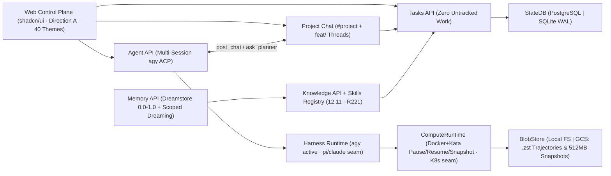
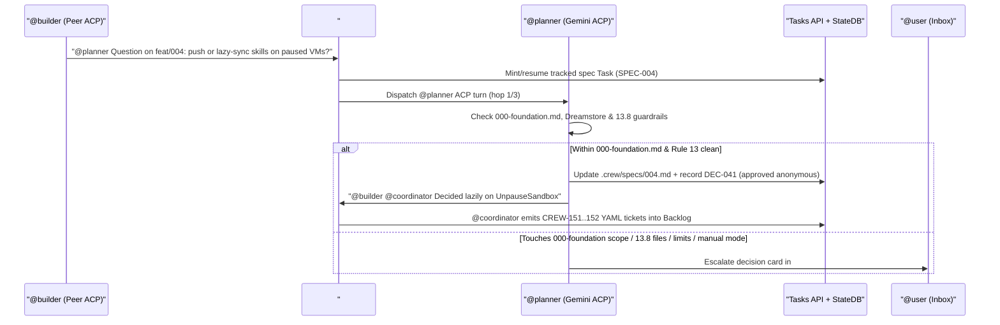

# Crew Software Factory — Complete Blueprint & Build Plan (Design 1.47, M21–M26)

> **BLUF:** Crew `1.47` evolves Crew's hardened v1.46 engine (`crew-db`, quarantine/canonical git, Kata + Cloud Hypervisor warm microVMs, `internal/redact`, `internal/fence`, and `agy acp`) into a self-hosted **Software Factory per project** built around **seven clean modules** (`Tasks API`, cross-project `Knowledge API` + `Skills Registry`, `Memory API`, `Agent API`, `Harness Runtime`, `ComputeRuntime`, and `StateDB + BlobStore`), **autonomous `@agent -> @planner` feature spec decisions** within `000-foundation.md` and `13.8` guardrails, **one `#<project>` channel + per-feature thread chat** where peer agents share messages, and a **`shadcn/ui` control plane shipping all `40` runtime-switchable themes**.

---

## 1. Non-Negotiable Crew v1.46 Foundations Preserved

Every milestone `M21`–`M26` inherits Crew's safety invariants from `AGENTS.md` and `docs/plan/agent-kanban-tdd.md`:

| Guardrail | Mechanism Kept Verbatim |
|---|---|
| MicroVM Isolation | Each project runs inside its own Kata + Cloud Hypervisor microVM (`crew-proj-<project>`) with per-run git worktrees and throwaway check sandboxes. |
| Server Sole Authority | Only the Go server writes to `StateDB` and `main`. Sandboxes push only to task branches over Crew's quarantine git endpoint. |
| Untrusted Agent Data | Files, logs, web fetches, cross-factory knowledge, and peer chat messages pass through `internal/fence` (`Rule 14`) and `internal/redact`. |
| Credential Custody | SSH key, `gh` login, and encryption keys stay on the server. `ANTHROPIC_API_KEY` is forbidden inside all sandboxes (`Rule 11`). |
| Protected File Guard (`13.8`) | `WORKFLOW.md`, `.agents/skills/`, `.github/workflows/`, and harness instructions are read strictly from `main`; edits require explicit operator confirmation. |
| Operator Project OK (`Rule 12`) | Agents cannot give a new project its initial OK, install code releases, or deploy. |
| Model Family Policy (`Rule 15`) | `@planner`, `@coordinator`, `@builder`, `@researcher`, `@tester`, and `@dreamer` run on Gemini (`pro`/`flash`) unless pinned by the operator; judging (`@reviewer`, `@verifier`, stage judges) uses Anthropic (`claude`) with `3p` quota fallback to Gemini + inbox notice. |

---

## 2. Seven-Module Control Plane Architecture

| Layer | Module | Design Ref | Core Contract |
|---|---|---|---|
| Domain API | **Tasks API** | `6.8`, `7.14`, `R217` | Mandatory work boundary. Every unit of agent compute (`spec`, `feature`, `fix`, `chore`, `docs`, `research`, `dream`, actionable chat turns) holds a Task ID, `.crew/tickets/<KEY>.md` YAML mirror, token ledger, and Trajectory trace. Code work (`feature`, `fix`, `chore`, `docs`) flows through Kanban `Backlog` -> `Done`. |
| Domain API | **Knowledge API** | `9.11`, `R218` | Installation-wide secret-scrubbed (`internal/redact`) & provenance-fenced (`internal/fence`) repository of cross-factory skills, bug advisories, and reusable architectural patterns. Never shares sandboxes or keys; acting on an advisory mints a tracked `Tasks API` item. |
| Domain API | **Skills Registry** | `12.9`, `12.11`, `R221` | Four-tier unified catalog (`Base Harness`, `Cross-Factory Shared`, `Project/Dream-Synthesized`, `Vendored External` SHA-pinned in `.agents/skills/VENDORED.md`) with static AST vetting, `request_skill` Jaccard `>= 0.5` deduplication, per-factory task installation, live overlay sync to warm Kata VMs, and pass-delta telemetry. |
| Domain API | **Memory API** | `9.10`, `10.8`, `R215`–`R216` | Project-scoped **Dreamstore** (`episodic`, `semantic`, `procedural`, validity `0.00`–`1.00` with commit-drift decay, pass boosts, and `< 0.4` quarantine) + **Scoped Dreaming** restricted to harness micro-edits, `SKILL.md` synthesis, and vetted external skill imports. |
| Domain API | **Agent API** | `11.10`, `R212`, `R214` | Multi-session ACP peer control plane (`1 session = 1 peer agent`, `agy` internal CLI subagents disabled): `POST /agents/sessions`, `/turn`, `/steer`, `/abort`, `/stream`, health heartbeats, `@coordinator` dispatch, `max_tries -> @researcher` escalation, and bounded `#<project>` / feature-thread routing. |
| Runtime | **Harness Runtime** | `11.10`, `12.2`, `12.11` | `internal/cli/` adapter (`agy acp --stdio --process-per-session` live; clean interface seam kept open for `pi` and `claude`), `baseline/WORKFLOW.md` inheritance from `main`, live-synced Skills Registry overlay into `.gemini/config/skills/`, and scoped MCP tokens. |
| Runtime | **ComputeRuntime** | `13.12`, `R219` | Formal interface (`Start`, `Exec`, `Suspend`, `Resume`, `Snapshot`, `Restore`, `Stats`, `Destroy`) over existing Docker + Kata `PauseSandbox`/`UnpauseSandbox` (`internal/orchestrator/project_vm.go`) and credential-stripped sealed `.tar.gz` home snapshots (`internal/sandboxes/snapshot.go`), ready for future Kubernetes (`RuntimeClass: kata`). |
| Storage | **StateDB + BlobStore** | `5.1`, `6.8`, `R220` | Option A Split Storage: relational `StateDB` (`PostgreSQL` `crew-db` default or embedded `SQLite` WAL for lightweight installs) + immutable `BlobStore` (`Local FS` or optional `GCS`) holding `.jsonl.zst` trajectory archives and `512 MB` sealed microVM snapshots. |

---

## 3. Two-Tier Planning: Manual Foundation + Autonomous `@agent -> @planner` Feature Decisions

Planning lives outside `Backlog` so design contracts converge cleanly before `@coordinator` emits executable YAML tickets:

1. **Tier 1 — Project Planning (`.crew/specs/000-foundation.md` + initial `WORKFLOW.md`):** Interactive with `@user`. Requires explicit operator Project OK (`Rule 12`) to initialize the factory.
2. **Tier 2 — Feature Planning (`.crew/specs/NNN-<slug>.md`):** Can be initiated **either** manually by `@user` **or autonomously by any peer agent** (`@builder`, `@coordinator`, `@researcher`, `@reviewer`, `@dreamer`):

- Default per-project setting: `approvals.feature_specs: autonomous` (declared in `WORKFLOW.md` and `board.yaml`).
- Every autonomous `@planner` resolution records a searchable Decision row (`decided_by: autonomous (@planner + <asking_peer>)`, alternatives, rationale) so `@user` retains full auditability and one-click override.

---

## 4. Unified Project Chat: `#<project>` Channel + Per-Feature Threads

Every project factory exposes **one canonical channel `#<project>`** (for factory-wide updates, feature thread roots, `@coordinator` queue shifts, `@dreamer` proposals, and `Knowledge API` advisories) and **one shared thread per feature (`feat/<NNN>-<slug>`)** containing all peer chatter across `SPEC-NNN` and its child `<KEY>` tickets:

- **Agent Chatter Shared Openly:** Peer agents (`@planner`, `@coordinator`, `@builder`, `@researcher`, `@reviewer`, `@security`, `@tester`, `@dreamer`) share messages directly inside `#<project>` and the active feature thread via Crew MCP tools (`post_chat`, `read_chat`, `ask_planner`).
- **Safety & Determinism Bounds:**
  - `max_agent_hops` (`default: 3`): prevents unconstrained agent-to-agent reply loops.
  - `internal/fence`: wraps peer messages with sender role and run provenance so another agent's message is treated strictly as data (`Rule 14`).
  - `Tasks API`: any actionable `@agent` ping mints or resumes a tracked Task ID before compute runs (`R217`).
  - **No Bypass Around Checks (`Rule 2`):** Chat carries read/comment authority only; tickets still advance solely through throwaway check sandboxes and cross-family verification.

---

## 5. Visual Control Plane & All 40 Shipping Themes (`DECISION.md` Locked)

Locked in [DECISION.md](simulation/ui-sim/DECISION.md) (`Status: DECIDED`):

- **Shell:** **Direction A** (`sidebar-07` inset collapsible control plane) with multi-factory switcher, responsive mobile sheet (`390px`), `⌘K` command palette, and live Coordinator/Kata gauges.
- **All 40 Runtime-Switchable Themes Ship in `web/` (`M25`):** Default `catppuccin` dark with light/dark mode toggle (`d`) and the **Theme Swatch Gallery (`Themes (40)`)** persisted per operator (`StateDB` + `localStorage`):
  - **11 Product & AI-Native:** `linear`, `claude`, `vercel`, `warp`, `supabase`, `vesper`, `flexoki`, `oxocarbon`, `poimandres`, `night-owl`, `synthwave` (all WCAG AA `>= 4.5:1` light & dark).
  - **9 Official `shadcn/ui` Presets:** `default`, `shadcn-zinc-blue`, `shadcn-stone-amber`, `shadcn-zinc-violet`, `shadcn-olive-emerald`, `shadcn-mauve-rose`, `shadcn-mist-cyan`, `shadcn-taupe-orange`, `shadcn-zinc-teal`.
  - **20 Dotfile & Editor Classics:** `catppuccin`, `catppuccin-macchiato`, `catppuccin-frappe`, `tokyo-night`, `tokyo-night-storm`, `tokyo-night-moon`, `dracula`, `one-dark`, `github`, `gruvbox`, `nord`, `rose-pine`, `rose-pine-moon`, `kanagawa`, `kanagawa-dragon`, `solarized`, `everforest`, `ayu`, `ayu-mirage`, `monokai`.
- **Interactive Simulations & Local Screenshot Suite:**
  - [ui-sim/index.html](simulation/ui-sim/index.html) (`10` views x `4` states x `7` overlays x `40` themes)
  - [crew-simulation.html](simulation/crew-simulation.html) (live state-machine mock with all `40` palettes, `#<project>` feature threads, and autonomous `@planner` simulation)
  - [docs/plan/screens/factory/](screens/factory/README.md) (`20` captured screenshots across views, light/dark themes, and `390px` mobile)

---

## 6. Milestone-by-Milestone Build Plan (`M21`–`M26`)

| Milestone | Scope & Reqs | Primary Packages & Files | Schema / API / MCP | Verification & Done-When (`crew/AGENTS.md` Rule 1) |
|---|---|---|---|---|
| **M21** | Multi-session `Agent API`, `Harness Runtime`, `ComputeRuntime` & `WORKFLOW.md` (`R209`, `R210`, `R212`, `R219`) | `internal/cli/agy.go`, `internal/cli/acp.go`, `internal/cli/adapter.go` (new), `internal/compute/` (new over `project_vm.go` + `snapshot.go`), `baseline/WORKFLOW.md`, `internal/httpapi/agent_api.go` | `workflow_defs` table; `/api/agents/sessions` (`/turn`, `/steer`, `/abort`, `/stream`); `ComputeRuntime` interface + Docker/Kata driver | `make check` green with fake `agy acp`; show two concurrent ACP peer sessions on one warm Kata VM with `PauseSandbox` -> `UnpauseSandbox` and `WORKFLOW.md` pinned to `main` under `13.8`. |
| **M22** | `Tasks API` zero-untracked-work gate, `@coordinator` dispatch & `max_tries -> @researcher` (`R211`, `R213`, `R217`) | `internal/board/`, `internal/runs/`, `internal/pipeline/`, `internal/research/` (new), `baseline/agents/coordinator.md`, `baseline/agents/researcher.md`, `baseline/stages/research.md` | `tasks.kind`, `tasks.spec_ref`, `tasks.origin_room`, `tasks.tries_used`, `tasks.max_tries`, `research_briefs`; `.crew/tickets/<KEY>.md` YAML serializer | `make check` green; show zero agent compute without a Task ID, `@coordinator` Backlog prioritization + Global Queue scheduling, and forced `3/3` failure triggering clean `@researcher` writing `<KEY>-research.md`. |
| **M23** | Two-tier Planning Studio (`000-foundation.md` manual + autonomous `@agent -> @planner` feature decisions, `R209`, `R217`) | `internal/planning/`, `internal/decisions/`, `internal/mcp/`, `internal/pipeline/breakdown.go`, `baseline/guides/planning.md` | `specs` (`000` vs `NNN`), `spec_decisions`, `approvals.feature_specs` setting (`autonomous` default); MCP `ask_planner`, `decide_spec` | `make check` green; show (1) `000-foundation.md` waiting on `@user` Project OK, (2) `@builder` asking `@planner` -> autonomous decision `DEC-*` + `Backlog` YAML emission, and (3) `13.8` file edit escalating to Inbox. |
| **M24** | Unified `#<project>` channel + per-feature thread chat & shared peer chatter (`R214`, `R217`) | `internal/rooms/` (new replacing `internal/assistant` 1:1 split), `internal/fence/`, `internal/mcp/`, `internal/httpapi/rooms.go` | `chat_rooms` (`1` per project `#<project>`), `chat_threads` (`feat/<NNN>-<slug>`), `chat_messages` (`hop_count`, `fenced`, `task_id`); MCP `post_chat`, `read_chat` | `make check` green; show shared peer chatter in `#<project>` and `feat/<NNN>`, `max_agent_hops: 3` loop stop, `<crew_data_fence>` wrapping peer text, and actionable chat pings minting Task IDs. |
| **M25** | Visual `shadcn/ui` control plane (**all 40 themes**), Skills Registry UI, Trajectory search, `StateDB` (`SQLite` mode) + `BlobStore` (`R220`, `R221`) | `web/src/` (`routes/`, `components/ThemeGallery.tsx`, `styles/themes-40.css`, `skills-registry.tsx`, `chat-rooms.tsx`), `internal/blobstore/` (`fs.go`, `gcs.go`), `internal/db/sqlite/` | `operator_prefs.theme` (`40` themes + `dark`), `trajectories_fts`, `BlobStore` driver config (`localfs` / `gcs`), `SQLite` WAL `StateDB` toggle | `make check` (`go test -race` + `npm run build` + `vitest run` + Playwright e2e); render all `10` views + switch across all `40` themes (`Themes (40)`) with `0` console/overflow errors and verified `BlobStore` offload. |
| **M26** | `Memory API` (`Dreamstore` + Scoped Dreaming), `Skills Registry` backend, & cross-project `Knowledge API` (`9.10`, `9.11`, `10.8`, `12.11`, `R215`–`R218`, `R221`) | `internal/memory/dreamstore.go`, `internal/dreamer/`, `internal/knowledge/`, `internal/skills/` (AST vet + `VENDORED.md` verify + warm-VM sync), `internal/redact/`, `internal/fence/` | `dreamstore_entries` (`validity_score`), `knowledge_entries`, `skills_registry`, `skill_installs`, `request_skill` Jaccard `>= 0.5` dedup | `make check` green; show `Dreamstore` commit-drift decay (`< 0.4` quarantine), scoped Dreaming `SKILL.md` proposal behind `@user` OK, AST block on unsafe skill, live sync to warm Kata VMs, and cross-factory scrubbed advisory minting a Task. |
